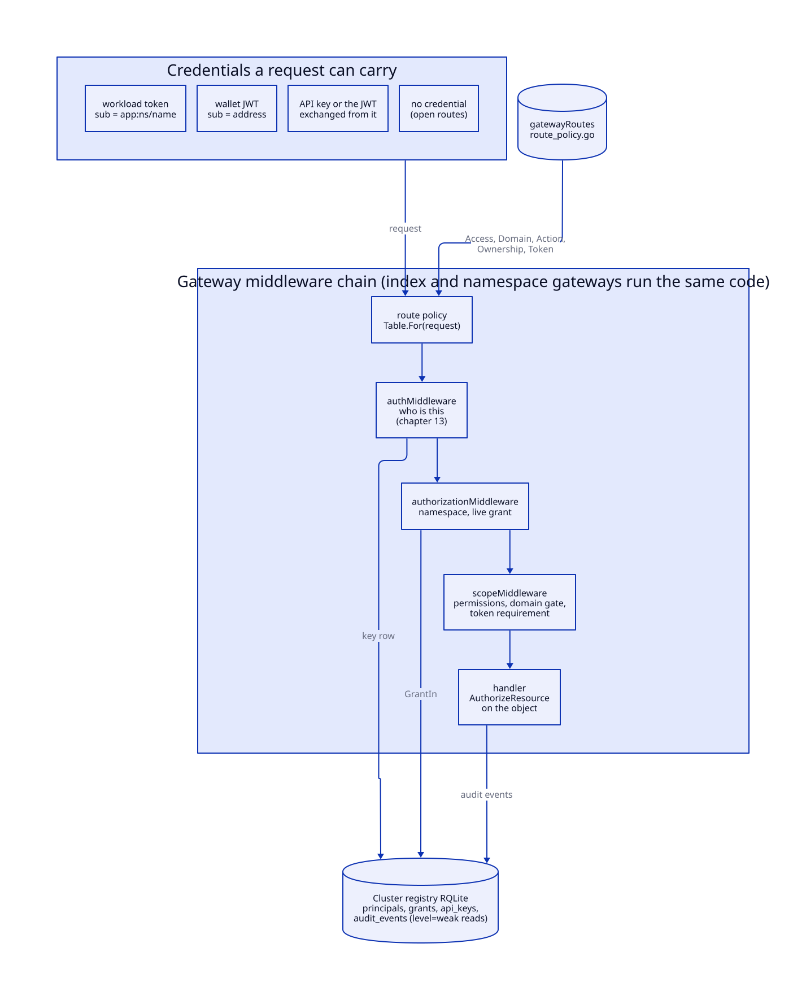
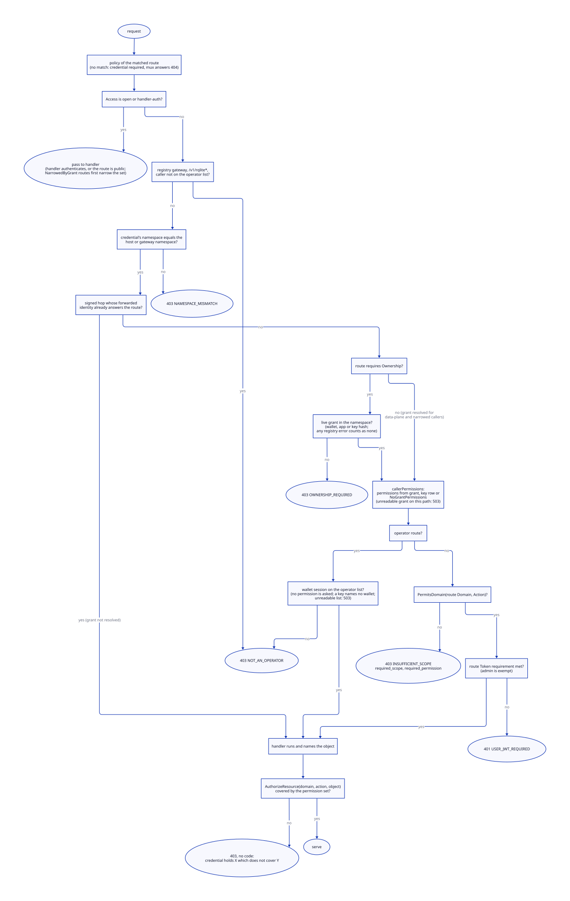
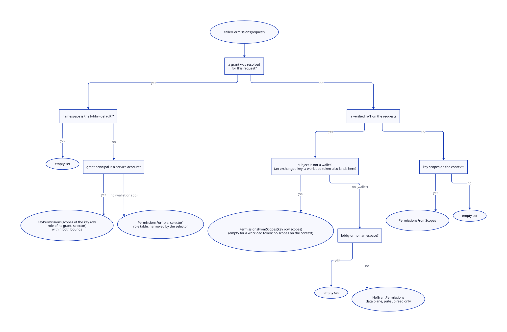
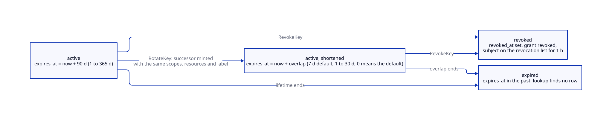
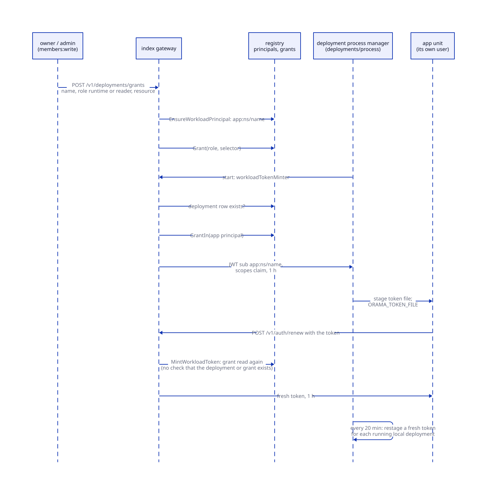

# Authorization

> **At a glance.**
>
> - **What:** the rules that decide what an authenticated caller may do. A credential (a wallet session, an API key, or a deployed app's workload token) is mapped to a set of permissions of the form `domain:action:resource`. The set comes from a live grant in the cluster registry (a role in a namespace, optionally narrowed to a resource and optionally expiring), from the key's own row, or from a fixed default for a signed-in wallet with no grant. Every route declares what it needs in one table, and the check runs twice: a gate by domain and action before the handler, and a check by object inside it.
> - **Key numbers:** 14 permission domains, 5 roles; 179 declared route patterns, 24 open and 26 authenticated by their own handler (`core/pkg/gateway/route_policy.go:buildRoutePolicies`); a wallet's data-plane grant is cached 10 s, a key's row 60 s; keys live 90 days by default and at most 365, rotation overlaps 7 days by default and at most 30; a workload token lives 1 h; audit events are kept 90 days.
> - **Code:** `core/pkg/gateway/auth/` (permissions, grants, keys, workload tokens, audit), `core/pkg/gateway/routepolicy/`, and the gates in `core/pkg/gateway/` (`scope_policy.go`, `forwarded_grant.go`, `narrowed_grant.go`, `middleware.go:authorizationMiddleware`, `members_routes.go`, `keys_routes.go`, `app_grants_routes.go`), and `core/pkg/attest/`, which verifies device attestations (proof that a caller is a genuine app build on a genuine iPhone or Android device), and the gateway's enforcement of them (`core/pkg/gateway/auth/attestation_*.go`, `core/pkg/gateway/handlers/attest/`, `core/pkg/gateway/attestation_middleware.go`).
> - **Depends on:** [identity](13-identity.md) for who the caller is (sign-in, tokens, sessions, revocation), [gateway architecture](12-gateway-architecture.md) for the middleware stack this chapter's gates sit in, and [cluster state](07-cluster-state.md) for the registry RQLite where grants live.



## Why it exists

Identity answers "who is this". The gateway must also answer, on every request, "may this caller do this, here, to this object". Three facts shaped the answer.

First, one namespace has callers of very different trust. The owner and the people who run the application hold the control plane (deployments, secrets, the raw database, who else is a member). The application's own code and its end users hold the data plane (storage, pub/sub, cache, push, function calls). A key shipped in a browser or mobile bundle is public the moment it ships, so it must not reach the control plane, turn into a logged-in user or destroy what the application's users stored.

Second, authority has to be changeable after it is handed out: a member is demoted, a key leaks, a deployment is compromised. A token is valid until it expires, so what it carried at mint time cannot be the answer. The gateway reads authority from the registry on every request, through short caches whose lifetimes are named constants, and treats the token as identity only.

Third, the old design could not express what was wanted. A key stored eight flat scope words (seven data-plane ones and `admin`, which covered the whole control plane, 58 routes) while a grant carried `domain:pattern` selectors; neither could express the other. There could be no `developer` role, because every control-plane route required `admin`, and a grant could not be narrowed to a table or deployment without holding `admin` elsewhere (`core/pkg/gateway/auth/permission.go`, the package comment). The current model is one sentence: in this domain, this action, on this resource. A scope word is the case where action and resource are `*`; `admin` is where all three are.

Nothing may be reachable by accident. A route nobody declared a policy for cannot be registered, an unknown role grants nothing, an unreadable selector authorises nothing, and a grant that cannot be read refuses the request instead of widening it.

## The model

**Principal.** Who holds a grant: a row in `principals` with a `type` and an `identifier`, unique together (`core/migrations/050_principals_and_grants.sql`). There are three types: `wallet` (the identifier is the normalised address; an EVM address is lower-cased, a Solana address kept as signed), `service_account` (an API key, identified by its stored hash) and `app` (a deployed application, `app:<namespace>/<name>`). `core/pkg/gateway/auth/grants.go:PrincipalType` and `core/pkg/gateway/auth/workload.go:PrincipalApp` define them.

**Credential.** What the request carries: a wallet JWT (subject = address), an API key or the JWT exchanged from one (subject = the key's stored form), a workload token (subject = the app principal), or nothing ([identity](13-identity.md#access-tokens) covers verification). A subject is classified positively as a wallet (`core/pkg/gateway/auth/keyformat.go:IsWalletSubject`: a `0x` prefix, or 32 to 44 base58 characters); anything else is read as a key, which holds only what its row says. No key can pass as a wallet: a raw key contains an underscore, which is not base58, and none begins `0x`; the stored HMAC form is 64 hex digits, longer than any address.

**Grant.** What a principal may do in one namespace: a row in `grants` with a role, an optional resource selector, an optional expiry, and the creator. A grant is live when `revoked_at` is null, `expires_at` is null or in the future, and the principal's `disabled_at` is null. Revoking sets `revoked_at`; the row stays.

**Role.** A named permission set. The roles, weakest first (`core/pkg/gateway/auth/grants.go:roleRank`):

| Role | Permissions (`core/pkg/gateway/auth/permission_legacy.go:Permissions`) |
|---|---|
| `reader` | none: only the routes that ask for no permission |
| `runtime` | the data plane: `storage`, `pubsub`, `cache`, `webrtc`, `proxy` in every action, `push:write` and `fn:invoke`; not `push:send` |
| `developer` | the data plane, plus `db`, `deploy` and `secrets` in every action, plus `fn:manage` and `push:send`; not `members`, `namespace` or `audit` |
| `admin` | `*:*:*` |
| `owner` | `*:*:*`; exactly one wallet per namespace; the only role that may transfer the namespace |

A role the binary does not know (a newer gateway may have written one) grants nothing.

**Permission.** `domain:action:resource` (`core/pkg/gateway/auth/permission.go:Permission`). The domains:

| Domain | Plane | Covers |
|---|---|---|
| `storage` | data | objects in IPFS: upload, get, pin, unpin, fetch capabilities |
| `pubsub` | data | topics: publish, subscribe, presence |
| `cache` | data | keys in a distributed map |
| `push` | data | `write` registers devices and topics, `send` sends to any user or topic |
| `webrtc` | data | TURN credentials, signalling, rooms |
| `proxy` | data | the anonymity tunnel |
| `fn` | data | functions: `invoke` runs one, `manage` deploys, deletes and configures; `read` lists WebSocket connections |
| `db` | control | the tenant's SQLite databases, raw RQLite export and import, namespace restore |
| `deploy` | control | deployments, their domains and logs |
| `secrets` | control | deployment environment, push credentials, namespace backup |
| `members` | control | grants, API keys, deployment grants, session devices of users |
| `namespace` | control | a namespace's own settings (rate limit, session policy, WebRTC switches) and its deletion |
| `audit` | control | the audit trail |

The cluster itself is not a domain. Every permission comes from a role, grant or key in one namespace, and `*:*:*` is everything in that namespace and nothing of the cluster; the cluster's routes are the operator's ([Operators](#operators)). `ParsePermission` refuses `operator` like any unknown domain.

The actions are `read`, `write`, `invoke`, `manage`, `send` and `*`. `invoke` and `manage` exist because running a function and changing it are different authorities and neither is a read or a write of the same thing. `send` exists for the same reason in `push`: registering your own device is a write, and sending a notification to any user or topic of the namespace is an authority a client must not hold (bugboard #434). `*` in any position matches anything in it.

**Permission set.** The permissions a credential holds on this request (`core/pkg/gateway/auth/permission.go:PermissionSet`). It is computed once per request and carried on the context.

**Scope word.** The legacy storage format. A key row still stores a comma-separated list of nine words in `api_keys.scopes` (`admin`, `invoke`, `storage`, `push`, `push-send`, `webrtc`, `proxy`, `pubsub`, `cache`; `core/pkg/gateway/auth/scopes.go`). `core/pkg/gateway/auth/permission_legacy.go:PermissionsFromScopes` is the one place that turns them into permissions: `admin` is `*:*:*`, a data-plane word is its whole domain except `push`, which is `push:write:*` (it held every push action until 0.3.5), and `push-send`, which is `push:send:*`; `invoke` is `fn:invoke:*`, never `fn:manage`. An unrecognised word contributes nothing.

**Selector.** A string on a grant that narrows it to part of a namespace: `storage:avatars/*`, `pubsub:topic=chat.*`, `fn:name=checkout`, `cache:key=sessions/*`. It becomes one permission (`core/pkg/gateway/auth/permission_legacy.go:PermissionFromSelector`).

**Route policy.** What a route requires, declared once in a table (`core/pkg/gateway/routepolicy/policy.go:Policy`): the access class, a domain and action or the operator flag, whether the caller must hold a grant in the namespace, and what kind of token it must present.

**Lobby.** The namespace `default`, which belongs to nobody. A wallet that signs in without naming a namespace stands there. It holds no permission and no grant, and reaches only routes that ask for none, chiefly `POST /v1/namespaces`, which creates a namespace and makes the caller its owner (`core/pkg/gateway/auth/ownership.go:LobbyNamespace`).

**End user.** A wallet with no grant that signed in to a namespace whose owner opened sign-in: a session and nothing more, with no grant, membership or key. It holds `NoGrantPermissions`: the data plane except publishing to pub/sub (`core/pkg/gateway/auth/permission.go:NoGrantPermissions`), so push registration and not sending, and reading only the pub/sub topics the namespace lists for its end users (none by default).

**Operator.** A wallet on the cluster's `operators` list, signed in with a wallet session. Operator status is separate from any grant and from any permission: the scope gate checks it on every operator route, and the authorization gate on the raw-database routes of the index gateway ([operator routes](12-gateway-architecture.md#operator-routes)). An API key, a token exchanged for one or an app's workload token is never an operator's ([Operators](#operators)).

## How it works

### The route policy table

Every route the gateway serves is declared in `core/pkg/gateway/route_policy.go:buildRoutePolicies`, which builds a `routepolicy.Table` once at package initialisation. It replaced three hand-maintained lists of path prefixes (`isPublicPath`, `requiredScope`, `requiresNamespaceOwnership`) that nothing tied to the routes they described. Two incidents show the cost: `/v1/node/enroll` was exempted from the scope check but never added to the public list, so the key middleware refused its invite token as a bad API key; and `/v1/operator/*` matched none of the lists, so a key out of a public app bundle could mint a cluster invite (`core/pkg/gateway/routepolicy/policy.go`, package comment).

The policy fields ([routing and the policy table](12-gateway-architecture.md#routing-and-the-policy-table) in chapter 12 lists all of them; the ones that matter for authorization):

| Field | Meaning |
|---|---|
| `Access` | `Credential` (zero value: a key or JWT must resolve), `Open` (anyone), `HandlerAuth` (the handler authenticates the caller, so the middleware must not try). `Open` and `HandlerAuth` both skip the authorization and scope gates. |
| `Domain`, `Action` | What the route does. Empty means any valid credential. Strings, not the auth package's types, because a policy table must not depend on what it describes. |
| `Ownership` | The caller must hold a live grant in the namespace; this also resolves the grant onto the request. |
| `Token` | `AnyCredential` (a bare key suffices), `AnyToken` (some JWT: possession of a key proven by an exchange), `WalletToken` (a logged-in wallet), `PrincipalToken` (a logged-in wallet or a deployed app's own token, never a key). |
| `NarrowedByGrant` | An `Open` route whose handler applies the caller's selector (`/v1/invoke/`). |

The declared patterns split into 24 `Open`, 26 `HandlerAuth` and 129 that require a credential (a pattern with a request-dependent policy counts once, under the policy of a `GET`). Of the 129, 42 also require ownership, 24 are operator routes (the 16 under `/v1/operator/`, the four node routes `/v1/node/status`, `logs`, `command` and `leave`, and the four network routes) and 23 are deployment routes. Examples: `/v1/deployments/env/set` is `secrets:write`; `/v1/deployments/grants` is `members:write`, because handing a deployment authority is handing out authority; `/v1/db/sqlite/query` is `db:write`, because the endpoint runs whatever SQL the caller sends; `/v1/functions` is owned `fn:manage`; `/v1/audit` is `audit:read`, because the trail names a namespace's wallets and when they sign in. No route asks for `*:*:*` (`route_policy_test.go:TestRoutePolicy_noRouteAsksForEverything`): every namespace owner holds it in their own namespace. The cluster invite, which hands out every secret the cluster holds, asked for it until bugboard bug-55 and is an operator route now.

The fail-closed properties are structural, not conventional:

- `Table.For` hands a request that matches no declared pattern the zero `Policy`: a credential is required and no grant reaches anything. The mux then answers 404, and an unmatched path is never an open one.
- `Table` matches by feeding the request to a `http.ServeMux` holding the declared patterns, so the policy is chosen by exactly the rules that choose the handler. A path the mux would only reach through a redirect (needing cleaning, or the wrong case) resolves to nothing.
- `Mux.Handle` panics on a pattern with no declared policy, and `Table.Add` panics on a pattern declared twice (`core/pkg/gateway/routepolicy/policy.go:Mux`).
- `core/pkg/gateway/route_policy_test.go:TestRoutePolicy_thePublicSetIsTheOneThatWasReviewed` fails the build when an `Open` route is added without editing the reviewed set.

`AddDynamic` declares a policy that depends on the request. `/v1/functions/` asks the serverless package's own parser which operation it is (`core/pkg/gateway/route_policy.go:functionRoutePolicy`): invoke is `Open` with `NarrowedByGrant`, a capability-opened WebSocket is `HandlerAuth`, `ws` is owned `fn:invoke`, and everything else (deploy, delete, logs, triggers, secrets) is owned `fn:manage`. An earlier version read the path suffix, so `/v1/functions/secrets/invoke` counted as an invocation.

### The decision pipeline

[Chapter 12](12-gateway-architecture.md#the-middleware-stack) lists the full middleware stack. Three of its stages decide authorization, in this order. The policy is resolved once before any of them (`routePolicyMiddleware`) and read from the context, so the three cannot disagree.



**Authentication** (`authMiddleware`, [credential resolution](12-gateway-architecture.md#credential-resolution)) sets the credential on the context: the JWT claims, or the API key and the namespace and scope set from its row. On an `Open` or `HandlerAuth` route a missing or unknown credential passes through; on any other route it is refused (`AUTH_MISSING`, `AUTH_INVALID_KEY`, `AUTH_REVOKED`, `AUTH_EXPIRED`, `AUTH_UNAVAILABLE`; how tokens are verified is [identity](13-identity.md#access-tokens)). A failed registry read while looking up a key is reported as `AUTH_INVALID_KEY` (Known gaps).

**The authorization gate** (`core/pkg/gateway/middleware.go:authorizationMiddleware`) runs these steps in order:

1. An anonymous route passes. If its policy has `NarrowedByGrant` and a credential is present, the caller's grant is resolved first and, when it carries a selector, the narrowed permission set is put on the context, so a wallet narrowed to `fn:name=checkout` is held to it on a route open to everyone. This step only takes access away.
2. On the gateway that serves the cluster registry, `/v1/rqlite*` is refused to anyone not on the operator list (`core/pkg/gateway/core_registry_guard.go:requireOperatorForCoreRegistry`, `NOT_AN_OPERATOR`). It runs before the signed-hop shortcut, because a hop's MAC says a gateway authenticated the caller, not that the caller is an operator.
3. For a route the index gateway serves on an `ns-<name>` host, the credential's namespace must equal the host's.
4. If the request is a signed hop and `forwardedCallerNeedsGrant` says the forwarded identity already answers the route, the gate passes. The hop carries who the caller is and a key's scopes, not the grant. A key's scopes are its authority on a route that resolves no grant; a wallet's authority is its grant, so a wallet needs it resolved on every route that asks for a permission (`core/pkg/gateway/forwarded_grant.go:forwardedCallerNeedsGrant`).
5. On a namespace gateway, a credential of another namespace is refused (`NAMESPACE_MISMATCH`).
6. A route without `Ownership` still resolves the caller's grant when `forwardedCallerNeedsGrant` says one is needed, and carries it on the request; a forwarded wallet on an owned data-plane route takes this cached path instead of step 7. The data plane reads the grant through a cache, a control route live (below). A grant that cannot be read answers a plain 503, never the data plane (`core/pkg/gateway/narrowed_grant.go:refuseUnreadableGrant`).
7. A route with `Ownership` first runs `INSERT OR IGNORE INTO namespaces` and reads the namespace id (a failed insert answers 500 with the error text, a failed read `403 NAMESPACE_MISMATCH`), then looks the caller's grant up and refuses with `OWNERSHIP_REQUIRED` when there is none. The lookup tries a key's hashed form before the raw form (rolling-upgrade legacy) and a wallet's normalised form before the presented one, and a wallet JWT with no grant falls back to the API key it also presented. Any `GrantIn` error counts as no grant (Known gaps). The grant travels with the request.

**The scope gate** (`core/pkg/gateway/scope_policy.go:scopeMiddleware`) never authorises on its own; it only tightens. For a non-anonymous route it computes the caller's permission set (`callerPermissions`, next section) and stores it on the context. On an operator route (`Policy.Operator`) it asks no permission: it admits a wallet session on the operator list and refuses everyone else `403 NOT_AN_OPERATOR` (`core/pkg/gateway/operator_gate.go:requireOperatorCaller`, [Operators](#operators)). On any other route it asks two independent questions:

- Does the set reach the route's domain and action at all (`PermissionSet.PermitsDomain`)? If not, `403 INSUFFICIENT_SCOPE` with `required_scope` (the domain) and `required_permission` (for example `pubsub:write:*`) in the body, so a client that lacks a permission can read which one.
- Does the caller present the kind of token the route requires (`hasRequiredToken`)? An admin caller (`PermissionSet.IsAdmin`: a permission with all three parts `*`) is exempt, because the requirement exists to make a leaked data-plane key inert and an admin credential is not one. Otherwise `AnyToken` needs any verified JWT, `WalletToken` a JWT whose subject is a wallet, and `PrincipalToken` a wallet JWT or a workload JWT. Failure is `401 USER_JWT_REQUIRED`. The two checks are independent: creating a namespace needs a wallet and no permission.

Which routes ask for which token follows from what each protects. `storage` and `webrtc` require a principal token (a logged-in wallet or a deployed app, never a key), so a runtime key extracted from a client reaches neither. `proxy` requires a wallet, because the tunnel is an end user's anonymity. `pubsub`, `push` and `cache` accept a bare key. `DELETE /v1/storage/unpin/` requires only some token (`AnyToken`), so a userless server-side reclaim job can prove it holds a storage key by exchanging it. The unpin handler reaches every CID the namespace owns (`checkCIDOwnership`; a grant with no selector is not narrowed further), so the `storage` grant is the whole of what keeps a key out, and no key profile meant for an app bundle carries it (see [API keys](#api-keys)). `POST /v1/namespaces` and `GET /v1/namespace/list` require a wallet and no grant.

**The handler** is the third stage, and asks the object question (next sections).

### Where a request's permissions come from

`callerPermissions` is the single path from "a credential" to "a permission set". It replaced three paths that could disagree (an exchanged-key JWT carried an authoritative `scopes` claim, a wallet JWT used the resolved grant, a bare key used the scope set on the context), which made narrowing a grant bite at once for a wallet and only at the next token for a key. A token says who you are; what you may do is read from the grant.



In order (`core/pkg/gateway/scope_policy.go:callerPermissions`):

1. If a grant was resolved for this request:
   - in the lobby, the empty set (a cluster from before ownership was fixed may still record a grant for whichever wallet signed in first);
   - for a service account, `KeyPermissions(scopes of the key row, role of its grant, selector)`: the scopes say what the key reaches and the role bounds it, because a key's role is only ever `runtime` or `admin` and a key minted for `invoke` alone would otherwise hold a runtime role's whole data plane;
   - for a wallet or an app, `PermissionsFor(role, selector)`.
2. Otherwise, if a JWT was verified: a key subject gets `PermissionsFromScopes` of the key's row (not the claim copied into the token); a wallet in the lobby, or with no namespace, gets the empty set (a lobby session used to receive the data plane, so every signed-in wallet shared the index namespace's cache and pub/sub); any other wallet gets `NoGrantPermissions`.
3. Otherwise, if only a bare key's scopes are on the context, `PermissionsFromScopes` of them.
4. Otherwise nothing.

Every answer read from a key's scopes (the service-account case of 1, the key subject of 2, and 3) is then narrowed by the resources on the key's row, when it has any (`KeyResources.Narrow`, see [API keys](#api-keys)). A key is narrowed the same way however it is presented: bare, exchanged for a token, or forwarded across the proxy hop.

`PermissionsFor` applies the selector rule. A grant with no selector is the whole role. A grant with one holds exactly the one permission its selector describes, and only if the role reached it at the domain level (a `storage:avatars/*` selector on a `reader` yields the empty set); a selector that cannot be parsed yields the empty set. A selector therefore only narrows, and a narrowed grant holds nothing outside its own domain: a wallet narrowed to `pubsub:topic=chat.*` can no longer touch storage or the cache (`core/pkg/gateway/narrowed_grant_test.go:TestForwardedDataPlane_aSelectorInAnotherDomainDoesNotReachTheCache`).

### Permissions: grammar and matching

`ParsePermission` reads `<domain>:<action>:<resource>`; a two-part form `<domain>:<resource>` means every action and a bare domain means everything in it. Limits: at most 256 characters, printable ASCII, no spaces. Domain and action are lower-cased and checked against the closed lists above, so a typo is a refusal and not a permission that never matches; the resource is case-sensitive. `ParsePermission` has no production caller: grants parse selectors (`ParseSelector`) and code builds permissions. It exists for tests and the documented grammar.

`Permission.Permits(Resource)` is the object question. Domain and action match case-insensitively, a `*` in either position matches anything, and the resource is a glob where `*` stands for any run of characters including `/` (`core/pkg/gateway/auth/authorize.go:matchGlob`). `*` crosses the separator on purpose: `avatars/*` must cover `avatars/2026/03/me.png`, and a rule that stopped at `/` would quietly grant less than it appears to. There is no `?` and no character class.

Two rules make the check conservative:

- A request that names no object (`Resource.Name == ""`) is covered only by a permission whose resource is `*`: a CID this namespace recorded no name for, or an upload with no name, is something nothing could name, and "I could not work out what you are touching" is not a reason to allow it.
- The gate and the handler ask different questions of the same set. The gate asks `PermitsDomain` before the handler knows which object is meant; the handler asks `Permits` once it does. They used to be one question, which is how an unnamed object slipped through.

An empty `Resource.Action` matches a permission of any action, which is how the function invoke handler, which passes no action, is covered by `fn:invoke:checkout`.

### The object check in the handlers

`core/pkg/gateway/auth/authorize.go:AuthorizeResource` reads the permission set the scope gate put on the context and asks `Permits` for the object; a request with no set never went through the gate (a public route) and is not narrowed. Four data paths call it, each deciding what the name is:

| Domain | Name matched | Actions | Notes |
|---|---|---|---|
| `storage` | the name the object was uploaded with, normalised | read for get; write for upload, pin, unpin | `core/pkg/gateway/handlers/storage/authorize.go:authorizeCID` looks up the name recorded for a CID in `ipfs_content_ownership`. A CID with no recorded name is refused for a narrowed grant; a failed lookup is a 503. |
| `pubsub` | the topic | read to subscribe, write to publish | publish, publish-batch and the subscribe WebSocket; a frame sent on a socket the caller may not write to is not published |
| `cache` | `<map>/<key>` (`cache/authorize.go:cacheResourceName`) | read for get, mget, scan; write for put, delete | `mget` is all or nothing, because a silently narrowed answer looks like keys that were not set; `scan` filters, because its answer is the set it returns |
| `fn` | the function name | none | HTTP invoke and the invoke WebSocket. A function a caller may run that calls another through `function_invoke` runs that one as its own code; the selector bounds the entry points |

A storage name is normalised before it is compared (`core/pkg/gateway/auth/selector.go:NormalizeStoragePath`): empty segments and `.` are dropped, so `/avatars/me.png` and `avatars//me.png` are one object, and a name is at most 1,024 characters. `..` is refused, not resolved: a storage name is a label, and resolving `avatars/../keys/x` would let it match `avatars/*` while naming something else. A cache key is not a path and is not normalised: `sessions/../tokens/x` is a key named `../tokens/x` in the `sessions` map, and the map is what the grant names.

A refusal by `AuthorizeResource` is `403` with `{"error": "this credential holds X, which does not cover domain:action:name"}` and no `code` (see Known gaps).

### Roles and grants

A member holds one live grant per namespace. The write path (`core/pkg/gateway/auth/grants.go:writeGrant`):

1. `Grant` refuses an owner grant outright. Ownership is established by creating a namespace and moved by `TransferOwnership`; any other path to it is how the namespace-takeover bug worked.
2. The role must be one of the five, and the identifier is normalised (`NormalizeWallet`): a wallet in two capitalisations would be two principals.
3. A selector, if present, must parse (`ParseSelector`), its domain must be one of the four enforced ones (`SelectorEnforced`), and the role must hold the scope word the selector narrows (`Role.Scopes`; empty for `developer`, so a developer can carry no selector: Known gaps). A narrowing the data path does not apply is refused at write time, with a message naming the domains that are applied: otherwise `orama members list` would show a narrowed grant that authorises nothing.
4. The principal row is created if absent (`INSERT OR IGNORE`). An expiry must then be in the future (the HTTP route takes `expires_in_hours` between 1 and 8,760), and the grant row is inserted.
5. `keepNewestGrant` revokes every other live non-owner grant the principal holds in the namespace, in one statement keyed on the newest id, so two writes racing for one principal keep the same row. Writing a grant therefore replaces: `orama members add` is also how a role is changed or a selector removed. It used to add a row beside the old one, and a member demoted from admin to reader stayed an admin.
6. A unique-index conflict (`idx_grants_one_live`: one live grant per principal, namespace, role and selector) lands in `regrant`, which makes the existing row the grant in place: its expiry is set to the one asked for, and every other row is retired only after the surviving one is right, so the principal is never left without a grant.

Two partial unique indexes carry the invariants in the database rather than in code that must remember (`core/migrations/050_principals_and_grants.sql`): `idx_grants_one_owner` (one live `owner` grant per namespace) and `idx_grants_one_live`.

`RevokeGrant` sets `revoked_at` and never deletes: what somebody was once allowed to do is the question an incident asks. The owner cannot be revoked (`ErrOwnerCannotBeRemoved`, 409 on the route). It needs the RQLite client for an affected-row count; without one a revoke is indistinguishable from a no-op, so it refuses to run. `GrantIn`, the read every authenticated request makes, is one join of `grants` and `principals` filtered to live rows, owner role first, then the newest id.

`TransferOwnership` is one operation, never a revoke and a grant, because a namespace with no owner is claimable by whoever signs in next. It first writes an `admin` grant for the outgoing owner (so a handover does not lock the owner out), then moves the owner row to the new wallet with a single `UPDATE grants SET principal_id = ?`, then retires whatever the new owner held before. The route requires `grant.Role == owner`, since an admin who could transfer could take the namespace (`core/pkg/gateway/members_routes.go:transferNamespace`), and validates both wallets as real addresses (`siw.IsWalletAddress`): a namespace handed to a string no wallet can sign in as is lost. A transfer is held to the per-wallet cap (`max_namespaces_per_wallet`, default 10) as a create is: the `UPDATE` that moves the owner row carries the count, so two transfers racing to one wallet cannot both find room. A wallet already at the cap is refused `403 TRANSFER_REFUSED`, the owner keeps the namespace and nothing is written (the previous owner's admin grant is taken back if the statement loses). The refusal is generic on purpose: it names neither the recipient's count nor the limit, because a transfer would otherwise tell anyone the namespace count of any wallet; that the transfer is refused at all is one bit about the recipient, and the audit trail records the `namespace.transfer` failure with the recipient and the limit. A transfer does not check `namespace_creation` (who may create): the cap is the only limit a recipient is held to. A cap an operator lowers afterwards takes nothing from a wallet that owns more; it only stops that wallet receiving or creating another.

The HTTP surface (all `members:write`, owned, on the index gateway; bodies are capped at 4,096 bytes, 1,024 for transfer):

| Route | CLI | Effect |
|---|---|---|
| `GET /v1/namespace/members` | `orama members list` | live grants, strongest role first; a row with a selector carries `enforced` |
| `POST /v1/namespace/members` | `orama members add <wallet> --role --resource --expires-in-hours` | write a grant |
| `DELETE /v1/namespace/members/{wallet}` | `orama members remove` | revoke |
| `POST /v1/namespace/members/transfer` | `orama members transfer` | owner only |

`GET /v1/auth/whoami` answers "what am I allowed to do here": the principal type, the role, the legacy `grants` list, the selector and the grant's expiry (`core/pkg/gateway/handlers/auth/wallet_handler.go:describePrincipal`). A subject with no grant gets `role: null`, not an error: a wallet removed from a namespace still holds a valid token until it expires. A failed registry read gets the same answer.

### Selectors

Four domains apply selectors (`core/pkg/gateway/auth/selector.go:enforcedDomains`):

| Selector | Translated permission | Applied to |
|---|---|---|
| `storage:avatars/*` | `storage:*:avatars/*` | upload, get, pin, unpin |
| `pubsub:topic=chat.*` | `pubsub:*:chat.*` | publish, publish-batch, subscribe |
| `fn:name=checkout` | `fn:invoke:checkout` | function invocation, HTTP and WebSocket |
| `cache:key=sessions/*` | `cache:*:sessions/*` | get, mget, put, delete, scan |

The translation (`PermissionFromSelector`) strips the keyed prefix (`topic=`, `name=`, `key=`, `table=`), maps a trailing `:read` or `:write` to the action (`db:table=posts:read` is `db:read:posts`), and fixes the action of `fn` selectors to `invoke`, since managing functions was part of `admin`, which a selector could not narrow. A selector is at most 256 printable ASCII characters.

Two domains that look narrowable are not. `db` has no enforcing data path: nothing parses a statement for the tables it touches (the SQL guard is a denylist, see [the SQL guard](17-database.md#the-sql-guard)). `push` has nothing to name: a send names a user and optionally a channel, and rotating topics are random ids. Both are refused when the grant is written. That is the only filter: `PermissionsFor` does not consult `SelectorEnforced`, so a `db` or `push` selector already in a row (no write path creates one) would become a narrowed permission that the gate reads at the domain level and no handler narrows further. The other control-plane domains are not selector domains.

A stored selector this binary cannot parse authorises nothing (`Grant.Permits` returns an error, `PermissionsFor` the empty set). The alternative, ignoring the selector and handing over the whole role, would turn "may write to `storage:avatars/*`" into "may write to all storage" silently.

### Pub/sub reserved topics

Topics under `_orama/` belong to the platform (today `_orama/webrtc/<room>`, the WebRTC membership events); the prefix is matched case-insensitively (`core/pkg/gateway/handlers/pubsub/reserved_topic.go:isReservedTopic`).

Nobody may publish to a reserved topic through a route (`403 PUBSUB_RESERVED_TOPIC`; the platform publishes in-process), and publish routes refuse a payload carrying an `_orama` key (`PUBSUB_RESERVED_KEY`). A wallet with no grant may not subscribe to one and does not see it listed; a credential that can write pub/sub on the topic (`holdsTopicGrant`) may. A runtime key ships inside the applications that use it, so every user of such an application can read every room's membership with it; an application that needs membership private keeps it behind functions.

### Wallets with no grant

`NoGrantPermissions` is the set `callerPermissions` hands a signed-in wallet in a tenant namespace that has no grant for it: the data plane, except that its pub/sub is one `pubsub:read:<pattern>` per topic pattern the namespace lists for its end users, and nothing else in pub/sub. Without the write loss any end user could publish to any topic of the namespace, including those the application's functions publish authoritative events on (bugboard #733). The refusal is `403 INSUFFICIENT_SCOPE` with `required_permission: pubsub:write:*` and a message naming the two remedies: grant the wallet pub/sub write (a runtime grant, or `pubsub:topic=chat.*`), or publish from a function (`core/pkg/gateway/scope_policy.go:refusedPermissionMessage`). Announcing presence on a subscribe socket publishes `presence.join` and `presence.leave`, so it needs write too.

Without the read narrowing any end user could subscribe to every topic, list them and see who was present on them, including topics only the application's functions consume. The list is `namespace_session_policy.end_user_topics` (migration 090), a JSON array of at most 64 patterns (`MaxEndUserTopics`), empty by default, validated by `ParseEndUserTopics` (printable, no spaces, at most 256 characters, none under `_orama/`). It is set with `PUT /v1/namespace/session-policy` `{"end_user_topics": [...]}` or `orama namespace session-policy --end-user-topics`, which need `namespace:write`, and read with the device and sign-in policies' 5 s cache (`Service.CachedEndUserTopicsOf`). The scope gate loads it once per pub/sub request made by an end user (`core/pkg/gateway/end_user_topics.go:withEndUserTopics`) and refuses the request `503` when the registry cannot be read, rather than read a missing list as empty or as everything. With an empty list the gate refuses `/v1/pubsub/ws`, `/topics` and `/presence` with `INSUFFICIENT_SCOPE`; with a list, `authorizeTopic` refuses a topic outside it, and the topics listing and presence apply the same check (`subscribableTopics`, `PresenceHandler`). A pattern is a permission resource, so `*` matches any run of characters including `/`. A member's grant is unaffected, and so is a function socket that bridges topics to its users, since the function picks them.

Whether such a wallet may sign in at all is the sign-in gate (`RequireSignInAllowed`): a wallet with a live grant is let in, a namespace with no owner refuses everyone (`NAMESPACE_UNOWNED`), and otherwise the namespace's `sign_in` policy decides: `members` (the default; `NAMESPACE_NOT_OWNED`) or `open` (the wallet is an end user, and no key is minted: `ROLE_HAS_NO_KEY`). The policy and `SIGN_IN_CLOSED` belong to [identity](13-identity.md#sign-in-policy).

### API keys

**Format.** `orama_<type>_<payload>_<checksum>`, all base62 (`core/pkg/gateway/auth/keyformat.go:NewKey`). The type is `sk` for a key whose scopes include `admin` and `rk` for one that holds only the data plane; it tells whoever finds the string how bad the leak is, and does not decide authority, the scopes column does. The payload is 24 random bytes (192 bits). The checksum is CRC32 of the body, which is not a security property: it is meant to let a client or secret scanner recognise a key offline and a mistyped one be refused without a lookup, and nothing on the request path checks it (Known gaps). The key names no namespace: it used to be `ak_<24 base64url>:<namespace>`, so a key pasted into an issue or log line published which tenant it belonged to. `ak_` keys remain live rows until swept (`IsLegacyKey`, `RevokeAllLegacy`).

**Storage.** The key is stored as an HMAC-SHA256 hex digest under the gateway's `api_key_hmac_secret` and shown once, at creation (`core/pkg/gateway/auth/service.go:HashAPIKey`). The secret is mandatory: `auth.NewService` refuses to build without it (`ErrNoAPIKeyHMACSecret`) and `Config.ValidateConfig` refuses a gateway configuration without it, so no key is stored or compared in plaintext; `HashAPIKey` used to return the key unchanged when no secret was configured. `KeyFingerprint` (`key_` plus 12 hex digits of SHA-256) names a key in a log or response.

**Authority.** The `scopes` column, written at mint time from a validated list (`NormalizeGrants` refuses an unknown word). Profiles are the ergonomic spelling (`ProfileGrants`): `admin` is `admin`; `app-runtime` (also `runtime`, `app`) is `invoke`, `push`, `webrtc`, `proxy`; `invoke-only` is `invoke`. `app-runtime` omits `pubsub` and `cache` on purpose; a key that uses them is minted with them named. It omits `storage` because it is the profile for a key an app ships, and a key in a bundle is public: a token exchanged for a storage key may unpin any of the namespace's objects (above), so an extracted key holding `storage` could empty the namespace's storage. It held `storage` until migration 084 (`core/migrations/084_app_runtime_keys_drop_storage.sql`), which rewrites every live key whose scopes are exactly the old profile set (`invoke,proxy,push,storage,webrtc`) to the new one; a row records grants and not the profile, so a key minted with an explicit list that equals the profile's is treated as one, and every other set, `storage` alone included, is untouched. A gateway re-reads the row once its cached copy is `CredentialStaleness` (60 s) old, so an upgraded key's exchanged tokens stop unpinning within that bound. A gateway from before 084 still mints the old set during a rolling upgrade.

Which key goes where follows from that. An app that needs nothing before its user signs in ships no key: `/v1/auth/challenge`, `/v1/auth/verify` and `/v1/auth/refresh` are open routes and a public function's invoke route needs no credential, on the namespace gateway as on the main one, and after sign-in the user's session reaches the data plane. An app that must call functions before sign-in ships `invoke-only`, narrowed to those functions with `--resource`. A function that reclaims storage without a user is given a key minted with `storage` alone, held in the namespace's secrets, which is the key the unpin route's `AnyToken` exists for. A backend that sends push notifications over HTTP is given a key minted with `push-send`, kept on the server; no profile holds it. A key also gets a grant in its namespace (a `service_account` principal, role `admin` if its scopes include `admin`, else `runtime`; `RoleForScopes`), which is how the ownership gate recognises it. The grant is membership, not permission: `KeyPermissions` intersects it with the scopes. For a key, the runtime role reaches `push:send` as well as the data plane (`Role.keyPermissions`), so that a `push-send` key can send while a runtime member's wallet cannot.

**Resources.** A key may be narrowed to named resources at mint: `orama namespace keys create --scope invoke-only --resource fn:premium-status`, repeatable, or `'fn:premium-*'` for a pattern. They are stored beside the scopes, canonical (sorted, deduplicated, comma-separated) in `api_keys.resources` (`core/migrations/082_api_key_resources.sql`), because a key's authority is its own row and not the grant recording its membership; NULL is the whole of the scopes, which every key minted before the column is. A key holds a list where a grant holds one selector, because what an application ships with is usually a handful of functions sharing no pattern. `NormalizeKeyResources` (`core/pkg/gateway/auth/key_resources.go`) applies the grant's write-time rules to each selector through the same `validSelector`: it must parse, its domain must be enforced, and the key's scopes must hold what it narrows (`fn:` needs `invoke`). Two rules are a key's own: every scope the key holds must be narrowed by one of its resources, since a narrowed key reaches only what they match and a scope none narrows would be listed and reach nothing (`--scope app-runtime --resource fn:a` is refused, since push, webrtc and proxy would reach nothing; mint `invoke-only`); and an `admin` key cannot be narrowed, since admin is the control plane, which no selector reaches. At most 32 selectors, none containing a comma. Each refusal is `400` with the reason (`ErrInvalidGrant`). At request time `KeyResources.Narrow` keeps each selector's permission where the key's scope permissions cover its pattern taken literally, so a narrowed key holds exactly those permissions and nothing else; the function handlers then refuse every other function with the `403 FORBIDDEN` a wallet narrowed by `members add --resource` gets, on both HTTP invoke routes and the function WebSocket, and a public function outside the list included, as for a narrowed wallet. Managing functions is `fn:manage`, which a narrowed key never holds. The resources are read in the same lookup as the scopes, cached with them in the credential cache, and forwarded to a namespace gateway in `X-Internal-Auth-Key-Resources` under the v4 hop MAC ([inter-node trust](15-inter-node-trust.md)), so a narrowed key costs no round trip an unnarrowed one does not.

**Lifetime.** Every key expires: 90 days by default, at most 365 (`core/pkg/gateway/auth/scoped_keys.go:KeyLifetime`, `MaxKeyLifetime`). A key that lives forever is not on offer, because that is what migration 051 exists to end, and past a year an expiry does nothing a revocation would not do better. The lookup SQL excludes revoked and expired rows (`core/pkg/gateway/middleware.go:apiKeyByStoredSQL`).



**Rotation.** `RotateKey` mints a successor with the same scopes, resources and label (re-validated as a new mint's are), records `rotated_from`, and shortens the original's expiry to the overlap: 7 days by default (also for `overlap_days: 0`), at most 30 (`DefaultRotationOverlap`, `MaxRotationOverlap`). The original is not revoked, because revoking it as the new key is minted is an outage with no window to roll the new one out. The shortening only shortens (`expires_at > new expiry` in the `WHERE`). Revoking is the way to end a key now. A wallet's login mint likewise leaves the wallet's previous key alive and records the succession.

**Revocation.** `RevokeKey` sets `revoked_at` (the row is kept), revokes the key's service-account grant, and records a subject revocation under the key's hash for `maxExchangedTokenLifetime` (1 h), so the JWTs already exchanged from it, which verify on their signature alone, stop too. A token minted afterwards is a new grant and is not covered. If the grant or subject revocation fails, the error says the key is revoked but a stale path may still match it. The revocation list's mechanics (reload every 5 s, 10 s staleness bound, fail closed) are in [identity](13-identity.md#revocation).

**Exchange.** A key can be exchanged for a JWT (`/v1/auth/token`) whose subject is the key's stored form, never the raw key, because a JWT payload is only base64 and a 15-minute token travels further than a 90-day credential should. The token copies the key's scopes into a claim, which the gateway ignores: it re-reads the row on every request (`exchangedKeyScopes`).

**Management.** `POST/GET /v1/namespace/keys`, `DELETE /v1/namespace/keys/{id}`, `POST /v1/namespace/keys/{id}/rotate` and `POST /v1/namespace/keys/revoke-legacy` are `members:write`, owned and `MainGateway`, because keys live only in the cluster registry. The namespace comes from the caller's credential, never the request, and nothing limits which scopes the caller may mint: an `admin` member can mint an `admin` key. Create and rotate take `expires_in_days` (1 to 365), rotate also `overlap_days`, and create takes `resource` and `resources` (one list); list returns each key's `resources`; the CLI is `orama namespace keys create|list|rotate|revoke`.

**Sending a credential.** A key goes in `Authorization: Bearer`; the accepted spellings, the WebSocket-only query forms and the deprecation headers are in [credential resolution](12-gateway-architecture.md#credential-resolution). A Bearer value with two dots is a JWT and no key contains a dot (`core/pkg/gateway/auth/apikey_request.go:APIKeyAndFormFromRequest`).

### Workload identity

A deployed application is a principal of type `app`, with grants its owner chooses, and holds a token instead of a key. Before this, an app received `PORT`, its namespace and its gateway's URL and no credential, so every app that talked to the platform carried a pasted key: an application compromise was a namespace takeover, and nothing the workload did was attributable to it.



- **Granting.** `POST /v1/deployments/grants {name, role, resource}` (`members:write`; `orama app grants set`) records the principal (`EnsureWorkloadPrincipal`) and writes a grant. The route accepts only `runtime` and `reader`: an app with the control plane could deploy over itself, mint keys and read the raw database (`core/pkg/gateway/app_grants_routes.go:setAppGrant`). The restriction is in the route; `Service.Grant` accepts any role but `owner` for an app. A deployment nobody has granted anything reaches nothing, because starting every deployment with the data plane would be the permanent key it replaces. The route names a deployment that exists in the caller's namespace and has a name a deployment can have: a name containing `/` or `:` is refused `400` (the subject `app:<namespace>/<name>` could read as another namespace's), a deployment that does not exist `404` (deploy it first, then grant it), and neither is recorded, because a grant written for a name nobody had deployed would wait unused and apply to whatever was later deployed under it. No route removes an app grant: `reader` replaces one.
- **Minting.** `MintWorkloadToken` issues a JWT with subject `app:<namespace>/<name>`, a namespace claim and a `scopes` claim holding the grant at that moment, valid for `WorkloadTokenLifetime` (1 h). No grant, or a failed grant read, yields an empty set, never the data plane (`workloadScopes`). At start the gateway mints only for a deployment whose row exists (`core/pkg/gateway/workload_token.go:workloadTokenMinter`).
- **Staging.** systemd stages the token from a file only the gateway can write, exposed to the app at `$ORAMA_TOKEN_FILE`. The gateway mints a fresh token whenever it starts the unit, and every 20 minutes restages one for each running local deployment without restarting anything (`core/pkg/deployments/health/token_refresh.go:tokenRefreshInterval`), paced at 50 ms per deployment, so a staged token has at least 40 minutes left. A gateway-driven restart while the registry is unreachable uses the staged token only if more than 5 minutes remain (`core/pkg/deployments/process/manager.go:WorkloadTokenRestartMargin`).
- **Renewal.** The app calls `POST /v1/auth/renew` with the token it holds. `RenewWorkloadToken` accepts only a workload's own token (subject `app:`, namespace equal to the claim's) and mints a successor from a fresh grant read. It checks neither that the deployment nor that the grant still exists: a renewal after the grant was removed yields a token that reaches nothing, but nothing writes a revocation entry for an app subject, so a chain renewed within each hour does not end (Known gaps). A user session is renewed by its rotating refresh token instead; letting any access token mint its own successor would make a stolen one good forever.
- **Authority at request time.** The token's `scopes` claim is not read. The gateway resolves the app's grant on every route under the app principal, through the 10-second data-plane cache, which for a workload is also keyed by the token's `jti` and `iat`, so a new token reads the grant live. A selector narrows the app as it does a wallet. An app's admin answer is its grant now, not the `scopes` claim of a token minted before the grant changed, and a token whose subject names one namespace while its claim names another is refused wherever it is verified, not only when it asks to renew. A grant that does not cover the route is `403` (an app invoking a function it holds no grant for is `403 FORBIDDEN`, the shared RPC code, not one of the auth codes below); `401` is for a caller with no identity. An app's token is good in its own namespace only.

Storage and WebRTC accept a workload token as they accept a wallet (`PrincipalToken`), and the app's grant decides what it reaches. The anonymity proxy and tunnel, and creating or listing namespaces, stay a person's.

### Operators

Operator status gates the cluster's own routes ([operator routes](12-gateway-architecture.md#operator-routes)): every `/v1/operator/*` route, the node routes `/v1/node/status`, `logs`, `command` and `leave`, and the network routes `/v1/network/connect`, `disconnect`, and `status` and `peers` when no coordination MAC is presented. Each declares `operatorRoute()` (`Operator` and `MainGateway`, no domain), and the scope gate admits only a caller whose wallet is on the `operators` table (`core/pkg/gateway/operator_gate.go:requireOperatorCaller`, `core/pkg/gateway/handlers/operator/authorize.go:IsOperator`, case-insensitive). The wallet is the JWT subject when it is a wallet, and nothing otherwise (`core/pkg/gateway/handlers/operator/handler.go:WalletFromRequest`): an API key, a token exchanged for one and an app's workload token name no wallet, so none of them is an operator credential, whoever owns the key's namespace. No permission satisfies the gate: a namespace owner's or admin's `*:*:*` is everything in that namespace and nothing of the cluster. A wallet session in the lobby is enough; standing in a namespace adds nothing. An unreadable list answers 503, a caller not on it `403 NOT_AN_OPERATOR`. Most operator handlers check the list again (`requireOperator`, `operatorHandler.Authorize`); the node proxy handlers rely on the gate. The same wallet rule guards the raw-database routes of the gateway that serves the registry (`requireOperatorForCoreRegistry`).

Until bugboard bug-55 the operator routes asked for `operator:read` or `operator:write` (the invite for `*:*:*`), which an owner's or admin's `*:*:*` held. The node routes checked nothing else, so any namespace owner or admin key could command, read the logs of and remove the cluster's nodes; and an API key resolved to the wallet that owned its namespace, so an admin key of an operator's namespace passed every operator check.

### Device attestation

`core/pkg/attest/` decides whether a proof shows a genuine, unmodified build of a namespace's app on a genuine device. It is pure verification: it imports nothing of the gateway, holds no per-device state, and keeps challenges and device binding with its caller, which derives the iOS `clientDataHash` or the Android `attestationChallenge` and passes it in. The roots are compiled in; tests inject their own roots, clock and HTTP client.

**The API** (`core/pkg/attest/attest.go`). `attest.New(apple.New(), android.New(revocation, graphene))` returns a `Verifier` with three calls: `AttestIOS` (an App Attest attestation object), `AssertIOS` (an assertion made with a key stored from `AttestIOS`) and `AttestAndroid` (a key-attestation chain, leaf first). Each takes a `Policy`: the Apple team and bundle ids and `AllowDevelopment`; the Android package, the lowercase-hex SHA-256 of each accepted signing certificate, and `MaxPatchAgeMonths`; and a minimum version per platform. `Policy.ValidateIOS` and `ValidateAndroid` check one before use. A `Verdict` names the platform, the app id (`TEAMID.bundle.id` or the package), the signed app version (`""` when unknown), and per platform the App Attest key, counter, environment, validation category and receipt, or the Android security level, boot state, verified-boot key, whether that key is GrapheneOS's, and the OS, vendor and boot patch levels. A refusal is a `*attest.Error` (`core/pkg/attest/refusal/refusal.go`) whose `Kind` is what the client is told, `KindInvalid` (`ATTESTATION_INVALID`) or `KindAppUpdateRequired` (`APP_UPDATE_REQUIRED`), and whose `Reason` is one of a closed set of labels (`chain`, `revoked`, `nonce`, `boot_state`, `signing_cert`, ...) for counting refusals. Anything else, an incomplete policy or no revocation list yet, is the server's own error, `KindNone`.

**iOS** (`core/pkg/attest/apple/`). An attestation is checked in the order of Apple's "Validating apps that connect to your server": the CBOR object is decoded strictly (fxamacker/cbor with tags, indefinite lengths and duplicate keys forbidden, at most 4 levels and 16 items); `fmt` is `apple-appattest`; `x5c` chains to the Apple App Attestation Root CA (P-384, valid to 2045-03-15, `apple_app_attestation_root_ca.pem`) at the injected time; the credential certificate's extension `1.2.840.113635.100.8.2` holds `SHA-256(authData ‖ clientDataHash)`; the SHA-256 of its P-256 public point is the key id; the RP ID hash is `SHA-256(TEAMID.bundle.id)`; the counter is 0; the aaguid is `appattest` and seven zero bytes, or `appattestdevelop` only under `AllowDevelopment`; the credential id is the key id; and the COSE key in the authenticator data is the certificate's key. An assertion is an ECDSA signature by the stored key over `SHA-256(authenticatorData ‖ clientDataHash)` (the signed digest is the SHA-256 of that nonce), with the same RP ID hash and a counter strictly above the stored one; the verdict returns the new counter for the caller's compare-and-swap. iOS 27 and later append a CBOR map to the authenticator data of both, with `apple_bundle_version_01` (a string) and `apple_validation_category_01`. The map is read whenever bytes follow the fixed fields, whether or not the ED flag is set, because Apple's own sample sets only AT; unknown keys are ignored, a malformed map or trailing bytes are refused. The policy accepts validation category 4 (App Store) and 2 (TestFlight), 3 (development-signed) only under `AllowDevelopment`, and refuses every other category. The minimum version compares `CFBundleVersion` as up to three period-separated integers. iOS 26 and earlier sign neither value: such a build is proved genuine, its version is reported unknown and the minimum does not apply.

**Android** (`core/pkg/attest/android/`). The chain is checked as Google's reference verifier (`github.com/android/keyattestation`) checks it: at least three certificates; the last one's public key is one of the two compiled-in Google roots, compared as the DER SubjectPublicKeyInfo (the RSA-4096 root `serialNumber=f92009e853b6b045`, whose key is shared by its 2016, 2019 and 2022 certificates, and the P-384 Key Attestation CA1 that signs chains since 2026-02-01); each certificate names its parent as issuer and verifies under its key; every certificate but the leaf is inside its validity period, except that expiry is ignored when the certificate under the root carries a `serialNumber` attribute (a factory-provisioned chain, whose keys cannot be rotated); only the leaf carries the key description, so a chain extended below a genuine attestation key is refused; and no certificate's serial (lowercase hex, no leading zeros) is on Google's revocation list. The key description (OID `1.3.6.1.4.1.11129.2.1.17`) is parsed with cryptobyte, tag by tag: DER only, its eight fields, AuthorizationList tags strictly ascending (the high-tag-number form is read by hand, since cryptobyte reads only tags below 31). It is then accepted only when the attestation and KeyMint security levels are equal and at least TEE; the challenge is the caller's; `attestationApplicationId` names exactly one package, the policy's, and every signing-certificate digest it lists is one the policy accepts; the hardware-enforced root of trust says the bootloader is locked; the boot state is `Verified` (any vendor's key; the caller pins the key on first use) or `SelfSigned` with a key on GrapheneOS's list; and, under `MaxPatchAgeMonths`, the hardware-enforced OS patch level (YYYYMM) is no older than that many months. The minimum `versionCode` is checked last. Google Play services are used nowhere.

**The lists** (`core/pkg/attest/revocation/`, `core/pkg/attest/graphene/`, both on `core/pkg/attest/internal/feed/`). Each is held in memory and refreshed in the background; no request waits on a fetch. A refresh waits the server's `max-age` less `Age`, kept between 1 h and 24 h; a failed fetch keeps the last good copy and is retried after 15 min. With a cache file configured, each accepted copy is written atomically (`durablefile`) and reloaded at start, dated by the file's modification time. `Stale()` is true when no copy has been fetched or loaded within 72 h. Google's list (`https://android.googleapis.com/attestation/status`, about 180 KB, `max-age=86400`) is parsed strictly against Google's schema; until one is loaded, `AttestAndroid` answers the server error, not a refusal. GrapheneOS's list (`https://grapheneos.org/attestation.json`, `max-age=1800`, so refreshed hourly) is accepted only with its `attestation.json.sig`, an SSHSIG by the compiled-in `allowed_signers` key of `contact@grapheneos.org` in namespace `attestation keys`, exactly what `ssh-keygen -Y verify` checks; a list whose `timestamp` is lower than the accepted one is refused as a downgrade. A signed snapshot (timestamp 1776709772, 21 Pixel keys) is compiled in, so `SelfSigned` devices verify from the first start and no older list is ever accepted.

### Device attestation at the gateway

A namespace's **attestation policy** (`core/pkg/gateway/auth/attestation_policy.go`, table `namespace_attestation_policy`, migration `091`) says which app it admits: an iOS App ID (team and bundle id, `allow_development`, a minimum `CFBundleVersion`), an Android package with its accepted signing-certificate digests (`allow_grapheneos`, a minimum `versionCode`, a maximum patch age in months), and how long an Android attestation lasts (`reattest_interval`, default 7 days, 1 h to 365 days). Its mode is `off` (no row), `monitor` or `enforce`. `GET`/`PUT /v1/namespace/attestation-policy` (namespace write; `orama namespace attestation-policy`) reads and changes it; a `PUT` names the fields it changes, unknown fields are refused, and the whole policy is validated (`AttestationPolicy.Validate`, which uses `attest.Policy.ValidateIOS` and `ValidateAndroid`) before it is written and audited as `namespace.attestation_policy`. The lobby has none.

**Attesting.** A device-bound session (its token's `did`) asks `POST /v1/attest/challenge` for a challenge: 32 random bytes, base64url, a row in `nonces` filed under `attest:<did>` with purpose `attestation`, valid 5 minutes (`AttestationChallengeTTL`), at most 10 unanswered per device (the sign-in ceiling). The platform signs over `SHA-256(challenge ‖ did)` (`AttestationBinding`): App Attest's `clientDataHash`, Android's `attestationChallenge`. `POST /v1/attest/ios` (`key_id`, `attestation`) and `POST /v1/attest/android` (`chain`, leaf first, at most 10 certificates) consume the challenge with one conditional `UPDATE` first, so it is spent even when the proof fails, read the policy live, and call the verifier above. A verdict is recorded in `device_attestations`, keyed `(namespace, device)`: platform, app id, signed version, the iOS key id, public key and counter, or the Android verified-boot key and whether it is GrapheneOS's. The verified-boot key is pinned on the device's first attestation by the upsert's own condition (`WHERE verified_boot_key = '' OR verified_boot_key = excluded.verified_boot_key`), so a later attestation from the same device booting an OS signed with another key is `ATTESTATION_INVALID`; GrapheneOS is refused unless the policy allows it, whatever the verifier accepts. The answer is a fresh access token carrying the attestation (`ReissueAttested`). The three routes are `MainGateway` and in the credential rate limiter's bucket. The index gateway alone fetches Google's revocation list and GrapheneOS's list (cache files under `<data dir>/attest/`, `core/pkg/gateway/attestation_wiring.go`); a namespace gateway builds the same verifier and never runs the refreshers, since it only checks iOS assertions.

**The verdict travels in the token.** The access token's `att` claim (`AttestationClaim`: platform, app id, signed version, `dev`, `gos`, `attested_at`) is set only by the gateway and only for a token bound to a device, so it is signed into the same token as the device it was proved for, and `att` is a reserved name a claims provider cannot set. A refresh fills it (`attestationForToken`, only when the namespace's mode is not off): for Android from the device's record, for iOS only when the refresh's device proof carries an App Attest assertion over `SHA-256(proof id ‖ did)` (`DeviceProof.AppAttest`), checked by `AssertIOS` against the stored key and recorded with a compare-and-swap on the counter, so a replay or a race loses — once per refresh, never per request. A refresh is never refused for attestation's sake: one that cannot show it gets a token without `att`. Sign-in fills it for an Android device that attested before. The claim crosses the hop to a namespace gateway as `X-Internal-Auth-JWT-Att` under hop MAC v7 ([inter-node trust](15-inter-node-trust.md#the-internal-auth-hop)), and a function reads it with `get_caller_attestation` ([serverless](21-serverless.md)).

**Judging a request** (`core/pkg/gateway/attestation_middleware.go`). `attestationMiddleware` runs after `trafficAttributionMiddleware` and before `authorizationMiddleware`, on the index and the namespace gateways, and the index gateway also judges a request before forwarding it to a namespace gateway (`admitAttestedProxy`), with the credential it validated. Judged is the app surface: function invoke over HTTP and WebSocket (`isFunctionInvokePath`) and every route whose declared domain and action lie in `DataPlanePermissions` (storage, pub/sub, cache, push registration, WebRTC, proxy). Not judged: the control plane, operator routes, open routes and everything with no declared domain (sign-in, `/v1/auth/*`, the attestation routes), and a capability-opened function socket. Per request the cost is the in-memory policy copy and `JudgeAttestation` over the token's `att`: an Android attestation older than the interval is `ATTESTATION_REQUIRED`, another app id, a platform the policy does not name, a development key or GrapheneOS where not allowed is `ATTESTATION_INVALID`, and a signed version below the minimum is `APP_UPDATE_REQUIRED` (an iOS 26 install, which signs none, passes the minimum). Only a caller the policy would refuse is asked whether it is judged at all: a wallet holding owner, admin or developer (the cached grant read, `cachedRequestGrant`), a workload token, or a key whose scopes reach beyond the data plane (`HoldsControlPlane`) is admitted. Under `monitor` the request goes on; under `enforce` it is `403` with the code. Either way the index gateway counts it, by code, platform and mode, in the request metrics (`TrafficReport.Attestation`, cumulative since start); a hop that arrives signed is judged again and not counted twice.

**The policy copy** (`AttestationPolicies`) is every namespace's policy whose mode is not off, reloaded whole by one query when it is `RevocationRefreshInterval` (5 s) old, with one read in flight, and refused once it is `RevocationStaleness` (10 s) old and cannot be reloaded: an unknown policy is not "off", the request is `503 AUTH_UNAVAILABLE`. The gateway that records a policy applies it at once and keeps it over a reload that began before the write. A changed policy reaches every token already issued.

**Sockets.** A WebSocket the middleware judged at its upgrade carries the namespace on its context; the handlers register it with `HoldToAttestation`, and the socket sweeper asks its `wssession.Gate` (`attestationSocketGate`) every pass: under `enforce`, a socket whose current token the policy no longer admits is closed with `4403` and the code as the reason. A socket opened while the mode was `off` is not held. A capability carries no credential when used, so in a namespace that enforces `capability_mint` and `storage_fetch_cap_mint` refuse an invocation whose caller has no attestation (`core/pkg/serverless/hostfunctions/attestation.go`).

### Consistency and caching

Authorization state lives in the cluster registry (the index gateway's RQLite), never in a tenant's database: a tenant's owner can export that database whole and replace it by import, so anything the platform kept there would be state its subject can rewrite and the rest of the cluster never sees. A namespace gateway reaches the registry through a second client (`grantDB`), and a test fails when a migration creates a table nobody has placed in one database.

Both clients that read the registry (`core/pkg/gateway/dependencies.go:gatewayClientConfig`, and the one a namespace gateway builds for the index registry, `core/pkg/gateway/gateway.go:registryClientConfig`) read at RQLite `level=weak`, which routes the read to the leader. A follower's replica would answer 403 to a grant `orama members add` had just had the leader acknowledge, on the member's first sign-in on another node. The cost is one hop to the leader (about 1 to 2 ms over WireGuard) and, while the cluster has no leader, failing reads instead of stale ones: a control plane that answers late is preferred to one that answers with what it has not caught up on.

How long a change takes to land:

| Change | Takes effect |
|---|---|
| Revoking a key | at once on the gateway that records it, within 10 s on every other: the revocation list is consulted before any cache |
| Narrowing a key (a revoked grant, an edited row) | within 60 s on every gateway that had seen it: `CredentialStaleness` is the middleware cache's TTL (`core/pkg/gateway/middleware_cache.go`) and is a promise rather than a tuning knob |
| A key expiring | the lookup SQL stops matching it; a cached entry can serve it for up to 60 s |
| A wallet's or app's grant, role or selector changing, on the data plane | within 10 s on every node (`narrowedGrantTTL`) |
| The same, on a control route and on routes that resolve a grant live | on the next request |
| An end user of an open namespace losing sign-in | its session is refused at its next refresh |
| A deployment's grant changing | data plane: within 10 s (a new token reads live, see Workload identity); control route: the next request |
| A namespace's attestation policy changing | at once on the gateway that records it, within 10 s on every other, for every token already issued and every open socket it holds |

The 10 s data-plane cache exists because a grant read is registry round trips (about 300 ms, per `narrowed_grant.go`) on the hot path. `grantCache` holds up to 4,096 entries keyed by namespace and subject and caches "no grant" too; a failed read is never cached. Concurrent misses for one key collapse into one registry read on a context detached from the first caller, bounded at 10 s (`singleflight`). A full cache drops expired entries, then one arbitrary live one; it used to be emptied, which let a caller cycling through wallets flush every other caller's entry.

### Refusals and the error-code table

Every credential, namespace, scope and operator refusal carries `{error, code, hint}` (`core/pkg/gateway/auth_errors.go:writeAuthError`), plus fields that make it actionable (`required_scope`, `required_permission`, `namespace`, `credential_namespace`). A 401 carries `WWW-Authenticate: Bearer realm="gateway"`; a 503 carries `Retry-After`. The code is the contract: the SDK switches on it, and the list only grows.

`core/pkg/gateway/auth_codes_doc_test.go:TestAuthCodes_areAllInTheDocs` reads the constants of eight source files and fails when a code is a string constant there and absent from the documentation. This table is the complete list, re-verified against those files and every emission site for the HTTP status; the one code outside the eight files is `RATE_LIMITED`, from `core/pkg/httputil/rpc_error.go:ErrCodeRateLimited`.

**Credentials and authorization** (`core/pkg/gateway/auth_errors.go`):

| Code | HTTP | Means |
|---|---|---|
| `AUTH_MISSING` | 401 (403 at the ownership gate when the route needs an identity and the credential carries none) | no credential was presented |
| `AUTH_INVALID_KEY` | 401 | the key is not one this cluster knows (never issued, expired, or its registry lookup failed on a cache miss) |
| `AUTH_REVOKED` | 401 | the credential was revoked; sign in again or use a new key |
| `AUTH_UNAVAILABLE` | 503, `Retry-After: 2` | the gateway could not tell whether the credential was revoked (the revocation list is older than its 10 s bound and the registry cannot be read), or could not read the namespace's attestation policy; retry with the same credential |
| `AUTH_EXPIRED` | 401 | the access token expired; refresh it. Every auth path answers it: the gateway middleware, the namespace proxy and the serverless router; an expired token is never reported as `AUTH_MISSING` |
| `USER_JWT_REQUIRED` | 401 | the route needs a logged-in user (on storage and WebRTC a deployed app's own token also qualifies); a key alone is not enough. Also the anonymity tunnel's refusal of a non-user |
| `INSUFFICIENT_SCOPE` | 403 | the credential lacks a permission; `required_scope` is the domain and `required_permission` the full `domain:action:resource` |
| `NAMESPACE_MISMATCH` | 403 | the credential belongs to another namespace, or its namespace could not be resolved |
| `ORIGIN_NOT_ALLOWED` | 403 | a WebSocket upgrade whose `Origin` is not this host or a name under it |
| `OWNERSHIP_REQUIRED` | 403 | the credential holds no grant in this namespace; also a non-owner asking to transfer the namespace or to export or import its whole database |
| `NOT_AN_OPERATOR` | 403 | the caller is not a wallet session on the cluster's operator list (an API key never is) |
| `NAMESPACE_QUOTA` | 403 | the wallet already owns as many namespaces as one wallet may; a create is refused it, the message names the cap and the body carries no other field |
| `TRANSFER_REFUSED` | 403 | a transfer the recipient cannot take, for example a wallet at its namespace cap; it names neither the wallet nor the limit, the owner keeps the namespace and the reason is in the audit trail |
| `DESTINATION_NOT_ALLOWED` | 403 | the anonymity proxy refused the destination (private or local addresses) |
| `ATTESTATION_REQUIRED` | 403 | the namespace attests and enforces, and the caller's token carries no attestation, or its Android attestation is older than the policy's interval ([device attestation at the gateway](#device-attestation-at-the-gateway)) |
| `ATTESTATION_INVALID` | 403 | the token's attestation is of an app, platform, environment or OS the namespace does not admit |
| `APP_UPDATE_REQUIRED` | 403 | the attested build is older than the namespace admits |

**The relay** (`core/pkg/gateway/relay_errors.go`, and `RATE_LIMITED` from the shared RPC envelope):

| Code | HTTP | Means |
|---|---|---|
| `RELAY_DESTINATION_NOT_ALLOWED` | 400 | the relay reaches only a host under its allowed suffixes, on port 443, never an IP literal |
| `RELAY_UNAVAILABLE` | 503 | the relay could not carry the stream: Tor is down on the node, or the destination was not reached through it; it never connects directly |
| `RATE_LIMITED` | 429, `Retry-After` | too many relay streams from this address (per minute, or open at once) or on this node |

**Fetch capabilities** (`core/pkg/gateway/handlers/storage/fetch_cap_errors.go`):

| Code | HTTP | Means |
|---|---|---|
| `FETCH_CAP_MISSING` | 401 | a relayed download carries no `X-Orama-Fetch-Cap` header |
| `FETCH_CAP_INVALID` | 403 | the capability is forged, expired, for another CID or namespace, or not a fetch capability; one code for all of them, since which it was is of use only to somebody probing |
| `FETCH_CAP_REVOKED` | 403 | the capability, or the device that issued it, was revoked |
| `FETCH_CAP_REVOKE_KEY_INVALID` | 403 | a revoke by id without the `revoke_key` the mint returned for that id, or with another one |
| `FETCH_CAP_NOT_ALONE` | 400 | a fetch capability arrived beside a credential, which would tie the fetch to an account |
| `FETCH_CAP_DEVICE_REQUIRED` | 403 | a capability was minted from a session bound to no device (an API key or a workload token has none) |
| `FETCH_CAP_UNAVAILABLE` | 503, `Retry-After` | the gateway could not check or revoke the capability right now |
| `FETCH_CAP_REVOCATION_LIMIT` | 429 | the namespace already has 1,000 capability revocations in force; each stops counting when its capability expires, and revoking the issuing device refuses all of its capabilities in one row |
| `FETCH_CAP_REVOCATION_LIMIT` | 429 | the namespace already has 1,000 capability revocations in force; each stops counting when its capability expires, and revoking the issuing device refuses all of its capabilities in one row |

**Signing in** (`core/pkg/gateway/handlers/auth/signin_errors.go`, `challenge_errors.go`, `errors.go`). "Your signature did not verify" and "you signed the wrong message" are different problems:

| Code | HTTP | Means |
|---|---|---|
| `AUTH_MESSAGE_MALFORMED` | 401 | the message is not a Sign-In-With message this gateway can read |
| `AUTH_DOMAIN_MISMATCH` | 401 | the message names a domain this gateway does not serve |
| `AUTH_MESSAGE_EXPIRED` | 401 | the message is outside its own issued-at, not-before or expiry window |
| `AUTH_SIGNATURE_INVALID` | 401 | the signature does not recover the address in the message |
| `AUTH_CHALLENGE_INVALID` | 401 | the nonce is unknown, already used, or expired (one code for all three, so the endpoint is not an oracle for which wallets hold outstanding challenges) |
| `NAMESPACE_UNKNOWN` | 404 | no such namespace; `orama namespace create` makes one |
| `NAMESPACE_NOT_OWNED` | 403 | the namespace belongs to another wallet and the wallet holds no grant in it while the namespace's `sign_in` is `members` |
| `NAMESPACE_UNOWNED` | 403 | the namespace has no owner, so nobody may sign in to it |
| `NAMESPACE_HAS_NO_KEYS` | 403 | the lobby namespace has no keys; create a namespace first |
| `ROLE_HAS_NO_KEY` | 403 | a key was asked for by a member whose role a key cannot carry (`reader`, `developer`), or by an end user of an open namespace who holds no grant |
| `SIGN_IN_CLOSED` | 403 | the wallet holds no grant (never invited, or revoked, expired or disabled) and the namespace is not open: its session was refused a refresh. Issuing a new session is refused `NAMESPACE_NOT_OWNED` |
| `TOO_MANY_CHALLENGES` | 429, `Retry-After: 300` | the wallet holds as many unanswered challenges as it is allowed |

**Device-bound sessions** (`core/pkg/gateway/handlers/auth/device_errors.go`). The next move differs: sign a proof, ask another device, or accept that this key is done:

| Code | HTTP | Means |
|---|---|---|
| `DEVICE_REQUIRED` | 403 | the namespace requires sessions bound to a device |
| `DEVICE_KEY_INVALID` | 400 | the key is not a P-256 or Ed25519 public JWK, or is not the device the message names |
| `DEVICE_SIGNATURE_INVALID` | 401 | the device's signature over the sign-in message does not verify |
| `DEVICE_PROOF_REQUIRED` | 401 | a device-bound credential was presented without the device's proof |
| `DEVICE_PROOF_INVALID` | 401 | the proof is stale, reused, or not the device's |
| `DEVICE_REVOKED` | 403 | the device was revoked; its key can never hold a session again |
| `DEVICE_PENDING` | 403 (202 on sign-in) | the device waits for another of the account's devices to approve it |
| `DEVICE_NOT_FOUND` | 404 | the account has no such device |
| `DEVICE_KEY_TAKEN` | 403 | the key is enrolled for another account |
| `DEVICE_USER_CODE_MALFORMED` | 400 | a device-flow user code is not the shape the gateway issues |
| `DEVICE_LOGIN_MISMATCH` | 400 | the pending login is for another namespace or account, or is the other kind (a device link offered to a wallet, a plain login to a device) |
| `DEVICE_USER_CODE_MALFORMED` | 400 | a device-flow user code is not the shape the gateway issues |
| `DEVICE_LOGIN_MISMATCH` | 400 | the pending login is for another namespace or account, or is the other kind (a device link offered to a wallet, a plain login to a device) |
| `POLICY_SWEEP_INCOMPLETE` | 503 | the session policy is set, but revoking the end users' existing sign-in keys stopped partway; repeat the `PUT` |

**Device attestation** (`core/pkg/gateway/handlers/attest/errors.go`), from `/v1/attest/*` and the policy route. A refused proof says what it means, never which check refused it (the reason goes to the log):

| Code | HTTP | Means |
|---|---|---|
| `ATTESTATION_INVALID` | 403 | the proof does not show the namespace's app on a genuine device, or the device's pinned verified-boot key changed |
| `APP_UPDATE_REQUIRED` | 403 | the proof is genuine and the build is older than the namespace admits |
| `ATTESTATION_CHALLENGE_INVALID` | 401 | the challenge was never issued to this device, was used, or expired |
| `ATTESTATION_NOT_CONFIGURED` | 409 | the namespace's mode is off |
| `ATTESTATION_NEEDS_DEVICE` | 401 (no session or a key), 403 (a session bound to no device) | a proof is bound to a device |
| `ATTESTATION_MALFORMED` | 400, 413 | the request is not one the route reads |
| `ATTESTATION_POLICY_INVALID` | 400 | a policy that cannot be enforced as written |
| `ATTESTATION_CHALLENGE_LIMIT` | 429 | the device holds 10 unanswered challenges |

A server-side failure (the registry, an unloaded revocation list, which the verifier reports as `KindNone`) is a codeless 503.

Refusals that carry no code: the object check of the data paths (`403 {"error"}`), an unreadable grant on a data-plane or control route (`503 {"error"}`), and the pub/sub reserved-topic refusals, whose codes (`PUBSUB_RESERVED_TOPIC`, `PUBSUB_RESERVED_KEY`) sit in the pub/sub handlers, not in the seven files the test reads. The TypeScript SDK mirrors the codes as a typed error hierarchy ([SDKs](36-sdks.md)).

### The audit trail

`audit_events` holds what changed and who changed it (`core/pkg/gateway/auth/audit.go`). The 35 recorded actions (`AuditActions`) cover sign-in and its steps (`auth.challenge`, `auth.verify`, `auth.refresh`, `auth.refresh.replay`, `auth.logout`), device logins and revocations (`auth.device.*`), keys (`key.issue`, `key.revoke`, `key.rotate`, `key.revoke_all`), grants (`grant.add`, `grant.revoke`, `namespace.transfer`), namespace life (`namespace.create`, `.delete`, `.operator_remove`, `.backup`, `.restore`, `.session_policy`, `.sign_in_policy`, `.attestation_policy`), secrets, functions and deployments set and deleted, `operator.action`, `node.register`, `node.key.enrol` and `auth.legacy_credential`. A new action must be added to the list, which lets the `action` filter refuse a typo instead of returning an empty page.

Design points that matter for security:

- **Refusals are not recorded.** One row per 401 or 403 at the gates would let anyone with a network connection fill a table replicated to every node, so the record is of rare acts. The node heartbeat is not recorded for the same reason. Failed sign-ins are the exception ([identity's known gaps](13-identity.md#known-gaps)).
- **A write failure never fails the request.** The record is evidence, not a control; refusing a login because the audit row could not be written would turn a database blip into an outage. The failure is logged with "the audit trail has a hole in it".
- **The actor is never a credential.** A wallet is recorded as itself; anything else as `key:` plus 16 hex digits of the SHA-256 of the subject (`RedactSubject`), because every holder of `audit:read` can read the trail. Metadata is never a credential. The user agent is attacker-controlled text and is truncated. Fields are capped at 512 bytes, metadata at 2,048.
- **Retention.** 90 days. A pruner deletes in batches of 5,000 every 6 hours, because one enormous `DELETE` is a Raft entry every node applies at once (`AuditRetention`, `auditPruneInterval`, `auditPruneBatch`). That is at most 20,000 rows a day, so the table is bounded only while events arrive more slowly than that.
- **Reading.** `GET /v1/audit` (`audit:read`) returns the caller's namespace's events, newest first, 50 by default and 200 at most, with `action`, `principal` and `since` filters. The namespace comes from the credential, never the query string. `orama audit` and `orama audit --follow` use it. The cluster's own events (minting an invite, a node joining or claimed, a namespace deleted, which is recorded at cluster level so a namespace created again under the name does not inherit the previous tenant's trail) have no namespace and are reached by no namespace's credential; `GET /v1/operator/audit` returns them (`namespace IS NULL`, the same filters, served by the `(namespace, created_at)` index) to an operator only, and `orama audit --cluster` reads it.

## State it owns

| State | Holds | Writer | Reader | Where |
|---|---|---|---|---|
| `principals` | wallets, service accounts and apps: `type`, `identifier`, `disabled_at` | `ensurePrincipal`, the namespace create handler (`core/pkg/gateway/handlers/namespace/create_handler.go:CreateHandler`) | `GrantIn`, `ListMembers`, the owner lookup | cluster registry; migration `050` |
| `grants` | role, selector, expiry, `revoked_at` per principal and namespace; one live owner per namespace | `writeGrant`, `RevokeGrant`, `TransferOwnership`, `grantServiceAccount`, `revokeServiceAccount`, the namespace create handler | every authenticated request, through `GrantIn` | cluster registry; migration `050` |
| `api_keys` | HMAC of the key, label, scopes, resources, `expires_at`, `rotated_from`, `revoked_at`, `last_used_at` | `IssueScopedKey`, `GetOrCreateAPIKey`, `RotateKey`, `RevokeKey` | `lookupAPIKeyEntry`, `ListKeys` | cluster registry; migrations `051`, `082` |
| `audit_events` | namespace, actor, action, resource, result, ip, user agent, metadata, time | `AuditLog.Record` | `GET /v1/audit` | cluster registry; migration `048`; pruned at 90 days |
| revocation entries for a key's subject | the key's hash, for 1 h | `RevokeKey`, `RevokeAllLegacy` | the revocation list ([identity](13-identity.md#revocation)) | cluster registry |
| route policy table | one `Policy` per declared pattern | built at package initialisation | every request | memory, `gatewayRoutes` |
| grant cache | the grant (or its absence) per namespace and subject, 10 s, 4,096 entries | `cachedRequestGrant` | the data-plane gate | memory of each gateway process |
| credential cache | key to namespace, scopes and resources, 60 s | `lookupAPIKeyEntry` | `authMiddleware` | memory of each gateway process |
| workload token file | the staged JWT of one deployment | the deployment process manager | the app, through `$ORAMA_TOKEN_FILE` | the deployment's unit |
| Apple and Google attestation roots, GrapheneOS signer and list snapshot | the trust anchors of device attestation | the release | `core/pkg/attest/` verifiers | compiled into the binary (`go:embed`) |
| Google's attestation revocation list | revoked and suspended attestation-certificate serials | `revocation.Refresher` | `AttestAndroid` | memory of each process; optional cache file |
| GrapheneOS's verified-boot key list | accepted `SelfSigned` boot keys and the list's timestamp | `graphene.Refresher` | `AttestAndroid` | memory of each process; optional cache file |
| `namespace_attestation_policy` | a namespace's attestation mode, iOS and Android app, minimums and re-attestation interval | `SetAttestationPolicy` | `AttestationPolicies`, `AttestationPolicyOf` | cluster registry; migration `091` |
| `device_attestations` | per namespace and device: platform, app id, signed version, iOS key and counter, Android verified-boot key pin | `storeAttestation`, the iOS counter compare-and-swap | `attestationForToken` | cluster registry; migration `091` |
| attestation challenges | one `nonces` row per challenge, `attest:<did>`, 5 min | `IssueAttestationChallenge` | `consumeAttestationChallenge` | cluster registry; reaped with the other nonces |
| attestation policy copy | every namespace's policy whose mode is not off | `AttestationPolicies` reload, every 5 s at most | every request on the app surface | memory of each gateway process |
| attestation refusal counts | requests refused or, under monitor, would-be refused, by code, platform and mode | `attestationMiddleware`, `admitAttestedProxy` | the node report's `TrafficReport.Attestation` | memory of each gateway process, since start |
| `namespace_ownership` | the pre-050 ownership table, unread | nothing since migration 050 (expand only); no later migration drops it | nothing | cluster registry |

## Lifecycle

**Boot.** `gatewayRoutes` is built at package initialisation, so a duplicated pattern panics before the process listens, and `Routes()` panics on a route registered without a policy. A namespace gateway that cannot reach the registry fails to start rather than fall back to its tenant database. The audit pruner starts when a database is available.

**Normal operation.** Per request: resolve the policy, authenticate, authorize, check scope, run the handler, check the object. The audit log is written for rare events only.

**Rolling upgrade.** Migration 050 is expand-only: `namespace_ownership` stays in place, unread by the new release, because old gateways read and write it on every ownership check during the rollout; an owner an old gateway records exists only in the old table. A role written by a newer gateway reads as no permissions on an older one (`Role.Permissions` returns the empty set for an unknown role), so a new role fails closed. Key rows in an older format keep authenticating, since lookup is by stored hash. A selector an older binary cannot read authorises nothing.

**Restart.** Nothing here is held only in memory: the caches start empty and refill from the registry, and the revocation list reloads before it answers ([identity](13-identity.md#revocation)). A restart changes no one's authority.

**Node loss.** Reads go to the registry leader. While the index RQLite has no leader (an election takes a few seconds) grant and key reads fail and the gateway answers 503 where it can tell the difference; cached credentials keep working for their TTL.

## Failure modes

| Trigger | What the system does | What you observe |
|---|---|---|
| Registry has no leader or does not answer, grant read on a route resolved by `lookupRequestGrant` | The request is refused; the grant read is not cached | `503` "the caller's grant could not be read right now; retry shortly", no code |
| The same, on a route that goes through the ownership gate | `GrantIn` errors read as "no grant"; a failed namespace-id read reads as no namespace | `403 OWNERSHIP_REQUIRED` or `403 NAMESPACE_MISMATCH` (Known gaps) |
| Key lookup fails on a cache miss | The error is not told apart from an unknown key unless it is the revocation list's | `401 AUTH_INVALID_KEY`; once the revocation list is more than 10 s old, `503 AUTH_UNAVAILABLE` with `Retry-After: 2` |
| Revocation list unreadable for more than 10 s | Credentials cannot be checked and are refused | `503 AUTH_UNAVAILABLE` on every authenticated route |
| Grant revoked, role changed or selector narrowed | Data plane: next read after the 10 s cache. Control: next request | the caller goes from allowed to `403 INSUFFICIENT_SCOPE`, `OWNERSHIP_REQUIRED` or a selector refusal |
| Key leaked | `RevokeKey` ends the key, its grant and its exchanged tokens | `401 AUTH_REVOKED` or `AUTH_INVALID_KEY` within 10 s on every gateway |
| Key expires | The lookup no longer matches the row | `401 AUTH_INVALID_KEY`; up to 60 s of cached acceptance |
| Selector unreadable | `PermissionsFor` returns the empty set; `Grant.Permits` refuses | every request of that grant is refused |
| A narrowed grant hits a request with no nameable object | Refused, since only `*` covers an unnamed object | `403` from the handler; for a storage CID whose name cannot be read, `503` |
| Owner transfer fails midway | The old owner already holds admin; the owner row is moved by one statement | the namespace is never ownerless; the old owner holds owner and admin until the move |
| Clock skew between a gateway and the RQLite node | Expiries are written from the gateway's clock and compared with SQLite's `datetime('now')` on the node that serves the read | key and grant lifetimes shift by the skew |
| A namespace owner, admin or any API key on an operator route | No permission is asked; a key names no wallet; the owner's wallet is not on the list | `403 NOT_AN_OPERATOR`, even for an admin key of a namespace an operator owns |
| Google's revocation list cannot be fetched | The last good list is kept and used; retried every 15 min | a warning per failed fetch; `Stale()` true once the copy is more than 72 h old |
| No revocation list loaded yet (first start, no cache file, no network) | `AttestAndroid` verifies nothing | a `KindNone` error, not a refusal |
| GrapheneOS serves a list older than the accepted one, or one not signed by the pinned key | The list is refused and the current one kept | a warning; `Status().LastError` names the downgrade or the signature |
| An iOS release changes the extensions map's layout | A malformed map is refused | iOS 27+ attestations refused with reason `malformed` |
| Operator list unreadable on an operator route | Not knowing is not permission | `503`, the handler is not reached |
| Attestation policies unreadable for more than 10 s | An unknown policy is not "off": requests on the app surface are refused | `503 AUTH_UNAVAILABLE` on judged routes; the rest of the gateway is unaffected |
| A namespace switched to `enforce` | Unattested callers on the app surface are refused; open sockets judged at their upgrade are closed by the next sweep | `403 ATTESTATION_REQUIRED`; sockets close with `4403` and the code |
| A refresh's App Attest assertion is refused or loses the counter race | The token is minted without `att` | the next judged request is `403 ATTESTATION_REQUIRED`; a warning names the reason |

## Trust and security

**An unauthenticated client** reaches the 24 open routes, the login handshake and anything a handler authenticates itself; every other route needs a credential, and an undeclared route cannot register. The open set is reviewed by name in a test. It includes `/v1/chain/` (a bounded, allowlisted proxy), `/v1/proxy/relay` (a destination-pinned tunnel, rate limited by address) and `/v1/invoke/`, where the invoker decides whether the caller may run the function.

**The holder of a runtime key**, for instance one extracted from a browser bundle, holds at most the data-plane scopes its row names. It cannot reach the control plane, cannot reach `storage`, `webrtc` or `proxy` without a wallet or workload token (except unpin, which a token exchanged for a key holding `storage` reaches; no profile meant for a bundle holds it, see [API keys](#api-keys)), and cannot become a logged-in user (`hasWalletJWT` classifies a subject positively as a wallet). It can do what the application's own users can do through it: `pubsub`, push registration and `cache` on a bare key, and read every reserved `_orama/` topic. It cannot send a push: that needs `push-send`, which no profile carries.

**An end user with a wallet in an open namespace** holds `NoGrantPermissions`: nothing on the control plane, no publishing to pub/sub unless the application grants it or publishes from a function, and no pub/sub read beyond the topics the namespace lists for end users. Signing in writes nothing and gives no key.

**A member** holds a role. A `developer` can build and run but not decide who else may, change the namespace's settings, read the audit trail or touch the cluster. An `admin` can do everything but be the owner: it cannot remove or transfer the owner (`core/pkg/gateway/members_routes.go:transferNamespace`). An admin may add and remove other admins and mint `admin` keys; ownership is the only authority a grant cannot create.

**A tenant with raw SQL** cannot write the platform's authorization state: `grants`, `principals` and `api_keys` are authoritative only in the cluster registry, and the SQL guard on a namespace gateway refuses statements naming the platform tables that do share a tenant's database. Nobody is exempt, owner and admins included: an admin who could write `api_keys` would bypass minting and its scope checks, and one who could write `grants` would bypass the owner-only transfer. Whole-database export and import are the owner's alone (`refuseWholeDatabaseToNonOwner`), because a snapshot is every row and no statement filter sees it. A gateway with no configuration is treated as a namespace gateway, so the failure is refusal.

**A deployed application** holds exactly what its owner granted it, with a one-hour token, and cannot be granted the control plane. Compromising the app is not a namespace takeover.

**A namespace owner or admin**, and any key or app of a namespace, holds nothing of the cluster. The operator routes ask no permission, only a wallet session on the operator list, so an owner's `*:*:*` reaches no node, telemetry, setting, invite or key rotation, and an admin key of a namespace an operator owns is refused like any other: a key names no wallet. Operating the cluster takes the operator's own wallet session.

**A node, or anything holding the cluster secret,** can forge the hop that tells a namespace gateway who the caller is, which is why that header is MAC'd and why a wallet's grant is still resolved there ([inter-node trust](15-inter-node-trust.md#the-internal-auth-hop)). A compromised node can write the registry, and so a grant. Authorization here protects tenants from each other and from the Internet, not from a compromised node.

**A client that is not the genuine app.** A device attestation proves what Apple's or Google's hardware-rooted keys sign: the App ID and environment of an App Attest key, or the package, signing certificates, `versionCode` and boot state of an Android key generated in a TEE or StrongBox. A script holding an extracted API key and a fresh wallet session cannot produce one, and an APK re-signed with another certificate attests a digest the policy does not hold. What it does not prove: that the app's own code is unmodified on a device the attacker controls at the kernel level (a `Verified` boot state is what the device's secure hardware reports, and `attestationApplicationId` is filled by the OS), and on iOS 26 and earlier, which build of the genuine app is running.

**What the check does not hide.** A refusal reveals the held permission set to the caller, which is the caller's own data. Fetch capability, challenge and sign-in failures collapse several causes into one code, so a probe learns nothing about which check failed.

## Limits and scale

| Quantity | Value | Source |
|---|---|---|
| Permission or selector length | 256 characters, printable ASCII | `core/pkg/gateway/auth/selector.go:maxSelectorLength` |
| Storage name length | 1,024 characters | `maxStoragePathLength` |
| Key lifetime | 90 days default, 365 maximum | `KeyLifetime`, `MaxKeyLifetime` |
| Rotation overlap | 7 days default, 30 maximum | `DefaultRotationOverlap`, `MaxRotationOverlap` |
| Subject revocation of a revoked key | 1 h | `maxExchangedTokenLifetime` |
| Grant expiry on a member | 1 to 8,760 hours | `members_routes.go:maxGrantHours` |
| Wallet grant cache | 10 s, 4,096 entries, shared lookup bounded at 10 s | `narrowedGrantTTL`, `narrowedGrantCacheMax`, `grantLookupTimeout` |
| Credential cache | 60 s | `CredentialStaleness` |
| Workload token | 1 h; restaged every 20 min at 50 ms per deployment; restart needs more than 5 min left | `WorkloadTokenLifetime`, `tokenRefreshInterval`, `WorkloadTokenRestartMargin` |
| Audit page | 50 default, 200 maximum; kept 90 days; pruned 5,000 rows every 6 h | `audit_handler.go`, `AuditRetention` |
| Attestation list refresh | the server's freshness, kept between 1 h and 24 h; 15 min after a failure; stale after 72 h; fetch timeout 30 s | `core/pkg/attest/internal/feed/feed.go`, `revocation.StaleAfter`, `graphene.StaleAfter` |
| Attestation list size | revocation list 16 MiB, GrapheneOS list 1 MiB, its signature 16 KiB | `maxListBytes`, `maxSigBytes` |
| App Attest CBOR | 4 nesting levels, 16 items per array or map | `core/pkg/attest/apple/authdata.go` |
| Attestation challenge | 32 bytes, 5 min, 10 unanswered per device | `AttestationChallengeTTL`, `maxOutstandingNonces` |
| Attestation request | 64 KiB body, 10 certificates; policy `PUT` 16 KiB | `handlers/attest/handlers.go` |
| Re-attestation interval | 7 days default, 1 h to 365 days | `DefaultReattestInterval` |
| Attestation policy copy | reloaded at 5 s, refused at 10 s | `RevocationRefreshInterval`, `RevocationStaleness` |

**Cost of a request.** A data-plane request from a wallet costs a map lookup in the grant cache and one registry read per namespace and wallet per 10 s per gateway. An owned control-plane route goes through the ownership gate: several registry round trips (about 300 ms, in the code's own estimate) and, on the direct path, a Raft write, because the gate runs `INSERT OR IGNORE INTO namespaces` first ([chapter 12's known gaps](12-gateway-architecture.md#known-gaps)). Those routes are low volume. A key request costs a revocation-list check in memory, the credential cache, and a registry read per key per minute per gateway.

**Device attestation at 10x.** Verification CPU is spent at attest and refresh time only; a judged request costs a map lookup and the token it already carries, whatever the number of devices, because the verdict is in the token rather than in a per-gateway table of devices. The policy copy is one query every 5 s per gateway, sized by the namespaces that attest, not by all of them. A refused caller costs one cached grant read. Google's and GrapheneOS's lists are fetched by the index gateway once per node.

**At 10x the fleet or load.** Grant and key tables scale with members, not requests. Registry reads scale with active callers divided by the TTL, times the gateways that see them. A namespace with open sign-in and more than 4,096 distinct active wallets within 10 s on one gateway overflows the cache, which evicts one arbitrary live entry per insert, so each request then costs a registry read; single-flight collapses only concurrent misses for one key. The first bottleneck is the registry leader, because reads are at `level=weak`. The audit table is pruned at up to 20,000 rows a day.

## Design decisions

### One permission model, not scopes and selectors

*Chosen:* every credential holds `domain:action:resource` permissions; scope words and selectors are storage formats translated in one place (`permission_legacy.go`). *Rejected:* eight scope words plus a separate selector grammar. *Why:* they could not express each other, so there could be no `developer` role. Storage kept its shape, so every row stayed valid, and the round trip is tested per legacy word so no key gains access on the deploy that ships it.

### Authority is read from the grant, not the token

*Chosen:* a token states identity; `callerPermissions` reads authority from the grant on every request. *Rejected:* an authoritative `scopes` claim in the JWT. *Why:* a claim cannot change until the token expires.

### A narrowed grant holds exactly its selector

*Chosen:* a grant with a selector holds the one permission the selector describes, if the role reached it. *Rejected:* a selector as a filter over the whole role. *Why:* a filter leaves a "narrowed" wallet holding the rest of the role.

### The check happens twice

*Chosen:* a gate by domain and action, then an object check in the handler. *Rejected:* one check at the gate. *Why:* the gate runs before anything has parsed the request, so one check must allow the whole domain or parse every body.

### Operator authority is the operator list, not a permission

*Chosen:* operator routes ask no permission; the scope gate admits a wallet session on the cluster's operator list. *Rejected:* an `operator` permission domain, checked by the scope gate, with the list checked again in each handler. *Why:* a permission set is a namespace's, and `*:*:*` in a namespace held the domain, so the node routes, whose handlers checked nothing, were open to every namespace owner and admin key (bugboard bug-55). A key resolved to its namespace owner's wallet made the handler check no better. One gate for every operator route, reading only the list, leaves no route that forgot the second half.

### Device attestation without Play services, and its own verifiers

Android attestation uses the hardware key-attestation chain and Google's revocation list, both reachable without Google Play services, rather than Play Integrity, which GrapheneOS cannot pass. A `Verified` boot from any vendor is accepted and its key pinned on first use, as GrapheneOS's Auditor does, instead of an allowlist of vendors; a `SelfSigned` boot is accepted only with a key on GrapheneOS's signed list. The verifiers are written here rather than taken from a library because the Go App Attest and key-attestation libraries are unmaintained or predate iOS 27 and Key Attestation CA1; CBOR, the one format where a hand-written parser would be the larger risk, is decoded by fxamacker/cbor in strict mode.

### Fail closed on anything unknown

*Chosen:* an unmatched route requires a credential and grants nothing; an unknown role, selector or scope word grants nothing; an unreadable grant refuses. *Rejected:* defaulting to the data plane when a lookup fails. *Why:* reading a failure as "no grant" would widen a narrowed grant while the registry is unreachable. The cost is availability during an election. The ownership gate does not yet follow the rule (Known gaps).

### Soft revocation and mandatory key expiry

*Chosen:* soft revocation (`revoked_at`, rows kept), mandatory key expiry (90 days) and rotation that shortens the original to an overlap. *Rejected:* deleting, non-expiring keys, replace-on-rotate. *Why:* what somebody was once allowed to do is the question an incident asks; a key that works until someone remembers to revoke it is one nobody remembers; and revoking the old key as the new one appears is an outage.

### Workloads get identity, and no grants by default

*Chosen:* an `app` principal with a short-lived, renewable token and an empty grant until the owner grants `runtime` or `reader`. *Rejected:* a namespace key per deployment, or the data plane by default. *Why:* a pasted key makes an application compromise a namespace takeover and makes nothing a workload does attributable to it.

### Auth reads go to the leader

*Chosen:* the registry clients read at `level=weak`. *Rejected:* follower reads (`level=none`). *Why:* a new member's first sign-in on a lagging node answered 403.

### The audit trail records acts, not refusals, and never blocks

*Chosen:* rare events only, best-effort. *Rejected:* a row per refusal; failing the request when the audit write fails. *Why:* a row per 401 lets anyone fill a Raft-replicated table, and an audit outage must not become an authentication outage.

## Known gaps

- **A `developer` grant cannot carry a selector, and its legacy views are empty (bug).** `Role.Scopes` (`core/pkg/gateway/auth/grants.go:Scopes`) returns the empty set for `developer`, which has no scope words. `writeGrant` checks the selector against it, so `orama members add <wallet> --role developer --resource storage:avatars/*` is refused ("role developer does not hold the storage grant") although `Role.Permissions` gives a developer all of storage. `Grant.Scopes` is empty too, so `GET /v1/auth/whoami` reports `"grants": []` for a developer (`core/pkg/gateway/handlers/auth/wallet_handler.go:describePrincipal`). Authorization is unaffected, since it uses `Permissions`.
- **Registry read failures in the ownership gate read as "no grant" (bug).** In `core/pkg/gateway/middleware.go:authorizationMiddleware` the `grantFor` closure returns a grant only when `GrantIn` succeeds and treats every other outcome, a registry error included, as none, where `lookupRequestGrant` separates `ErrNotAMember` from a failed read. On a route with `Ownership`, an election or outage answers `403 OWNERSHIP_REQUIRED` where the caller should retry (a failed namespace-id read, `403 NAMESPACE_MISMATCH`). The gate, and the members, keys and app-grant routes, also write the raw error text of a failed registry call into a 500. `describePrincipal` and `workloadScopes` likewise turn a failed read into "no grant".
- **A key lookup failure is reported as an unknown key (bug).** `authMiddleware` answers `401 AUTH_INVALID_KEY` for any `lookupAPIKeyEntry` error except the revocation list being unavailable, and `exchangedKeyScopes` does the same for an exchanged token, so a registry failure on a cache miss reads as "not a key this cluster knows". Once the revocation list is 10 s old, `AUTH_UNAVAILABLE` takes over.
- **The key checksum is not used on the request path.** `ParseKey` and `LooksLikeKey` have one production caller, the plaintext-key migration (`core/pkg/gateway/auth/migrate_apikeys.go`). A mistyped key is not refused without a lookup: it goes through the revocation check, the cache and a registry query. Offline recognition by a secret scanner depends on a scanner pattern no code in this repository registers.
- **Resource refusals carry no code.** The object check in the storage, pub/sub and cache handlers answers `403 {"error": "..."}` with no `code` or `hint` (the function handlers answer the RPC envelope with `FORBIDDEN`), and an unreadable grant answers a codeless 503, although the error table promises a code for every refusal and the SDK cannot switch on these.
- **The rotation error message contradicts the code.** `core/pkg/gateway/keys_routes.go:rotationOverlap` maps `overlap_days: 0` to the default 7 days, while the error for a negative value says "0 ends the old key immediately". Ending a key now is `revoke`.
- **`principals.disabled_at` has no writer.** `GrantIn`, `ListMembers` and the device-policy sweep (`session_policy_keys.go`) filter on it and no code sets it, so a principal can be disabled only by direct SQL on the registry.
- **The contract migration for `namespace_ownership` was never written.** `core/migrations/050_principals_and_grants.sql` says the old table "is contracted in the next one", re-running the backfill and dropping it; migrations 051 to 076 do neither, so the table remains in every registry (`core/pkg/rqlite/schema_placement.go` still calls it "the next release drops it").
- **App grants are not cleaned up, and a workload token cannot be ended.** No route removes an app grant (`reader` replaces one), and deleting a deployment leaves its principal and grant, which a redeploy under the same name inherits. `RenewWorkloadToken` checks neither the deployment nor the grant and nothing writes a revocation entry for an app subject, so a token captured from a node renews indefinitely while its grant stands. `Service.Grant` does not restrict an app's role (only `setAppGrant` does). `setAppGrant` also records `grant.add` after `writeGrant` already did, so each app grant writes two audit rows, and its response says the grant applies "on the deployment's next token renewal", true of the retired `scopes` claim and not of the live read.
- **`jwt_handler.go` keeps a key lookup without the expiry predicate.** The fallback in `core/pkg/gateway/handlers/auth/jwt_handler.go` (taken when the middleware resolved no namespace) selects `api_keys` with `revoked_at IS NULL` and no `expires_at` condition, unlike `apiKeyByStoredSQL`; the middleware normally resolves the namespace first.
- **Selectors of unenforced domains are filtered only at write time, and the serverless invoker still reads an exchanged token's claim.** `PermissionsFor` never calls `SelectorEnforced` (see Selectors), and `getCallerHasInvokeFromRequest` in `core/pkg/gateway/handlers/serverless/types.go` falls back to the `scopes` claim of an exchanged-key token after the row-derived scopes; the two differ only if a key row was edited by SQL, since nothing edits `scopes`.
- **Stale comments contradict the code.** `core/pkg/gateway/auth/selector.go` says nothing enforces a selector (four domains do); `core/migrations/050_principals_and_grants.sql` says `developer` is not a role; `grants.go` says the only principal types are wallet and service account (`app` exists); `middleware_cache.go` says an empty scopes column means "grandfather=admin" (it means nothing).
- **Attestation leaves some sockets and settings behind.** A WebSocket opened while a namespace's mode was `off`, or opened with no credential at all on a public function, is not held to the policy when it is turned on (go through `monitor`). A signing-certificate digest removed from the policy applies at each device's next attestation, because the token carries the app id and version, not the digest. There is no way to revoke one device's attestation short of revoking the device. A public function in a namespace that enforces is refused to every caller without an attestation.
- **Attestation needs real devices to accept.** The gateway path is tested with a fake verifier and the fleet e2e covers refusals and monitor counts; that an iPhone, a stock Pixel and a GrapheneOS Pixel running the app's build are admitted, and that a re-signed APK and an old build are refused, is checked by hand with a real build.
- **The iOS 27 extensions are checked against Apple's one sample.** Apple documents `apple_validation_category_01` as a `UInt32`, but its validation-guide sample encodes it as a 4-byte little-endian byte string and signs bundle version `"1"` where the guide's prose says `"1.0"`; both encodings are read, and no capture from a shipping iOS 27 device has been checked.
- **A GrapheneOS signing-key rotation needs a release.** GrapheneOS signs a new `allowed_signers` with the old key (`allowed_signers.sig`); this is not followed, so after a rotation the list stops refreshing (and goes stale) until a release pins the new key.
- **Functions have no identity of their own.** Host calls run on the gateway's handles, so what a function does is not attributable to the function. A selector on `fn:name=` bounds the entry points a caller reaches, not what a function it may run does when it calls another.

## Verify it yourself

**Unit tests.**

```bash
cd core && go test ./pkg/gateway/auth/... ./pkg/gateway/routepolicy/...
cd core && go test ./pkg/attest/...
cd core && go test ./pkg/gateway/handlers/attest/ ./pkg/gateway/ -run 'Attest'
cd core && go test ./pkg/gateway/ -run 'TestRoutePolicy|TestCallerPermissions|TestForwardedDataPlane|TestNoGrant|TestHasRequiredToken|TestCredentialStaleness|TestAuthCodes'
```

- `core/pkg/gateway/auth/permission_test.go`: `TestPermissionsFromScopes_giveEachLegacyWordExactlyWhatItHad`, `TestPermissionsFor_narrowsAndNeverWidens`, `TestRolePermissions`, `TestPermits_aRequestWithNoObjectAsksAboutTheDomain`, `TestIsAdmin_meansEveryPermissionAndNotAWildcardSomewhere`; `keyformat_test.go` (`TestNewKey_carriesNoNamespace`, `TestParseKey_refuses`, `TestIsWalletSubject`); `workload_test.go` (`TestMintWorkloadToken_grantsNothingUntilSomethingIsGranted`, `TestRenewWorkloadToken_picksUpAGrantThatWasTakenAway`); also `selector_test.go`, `grants_sqlite_test.go`, `ownership_test.go`, `audit_coverage_test.go`.
- `core/pkg/gateway/routepolicy/policy_test.go`: `TestTable_unmatchedPathGetsTheClosedPolicy`, `TestMux_registeringAnUndeclaredRoutePanics`. `core/pkg/gateway/route_policy_test.go`: `TestRoutePolicy_everyRegisteredRouteIsDeclared`, `TestRoutePolicy_thePublicSetIsTheOneThatWasReviewed`, `TestRoutePolicy_onlyMintingAnInviteAsksForEverything`.
- `core/pkg/gateway/scope_policy_test.go`: `TestCallerPermissions_readsTheGrantAndNotTheToken`, `TestCallerPermissions_lobbySessionHoldsNothing`, `TestHasRequiredToken_principalTokenAdmitsAUserOrAnApp`. `narrowed_grant_test.go` and `role_data_plane_test.go` (the grant cache and data-plane role rules), `key_resources_test.go` here and in `auth/` and `handlers/serverless/` (a key narrowed to five functions, on every invoke route, bare, exchanged and across the hop), `no_grant_publish_test.go` (the grantless wallet), and `auth_codes_doc_test.go:TestAuthCodes_areAllInTheDocs` (the error-code table above).

- `core/pkg/attest/apple/appattest_test.go`: `TestVerifyAttestation_acceptsApplesValidationGuideSample` (Apple's iOS 27 sample with its extensions), `TestVerifyAttestation_realIOS14DevelopmentKeyNeedsDevelopmentAllowed` and `assertion` tests on a real iOS 14.4 attestation and assertion, and a generated CA for every refusal. `core/pkg/attest/android/real_test.go`: real Pixel (RKP, both roots), StrongBox and Sony (factory, expired intermediates) chains from Google's reference verifier, and Google's two malformed key descriptions; `generated_test.go`: a generated PKI for every refusal, the chain-extension attack included. `core/pkg/attest/graphene/graphene_test.go`: GrapheneOS's real signed list, tampering, other signers, downgrade and the cache.

- `core/pkg/gateway/auth/attestation_test.go`: the policy's validation and round trip to another gateway, `JudgeAttestation`'s table, single-use challenges bound to a device, the Android binding, record and boot-key pin, and the iOS assertion's compare-and-swap; `core/pkg/gateway/attestation_middleware_test.go`: enforce refuses a key, a session, a subscription and an old build, monitor counts and refuses nothing, what is not judged, the owner's exemption, sockets held to the policy, the proxy's judgement; `core/pkg/gateway/handlers/attest/handlers_test.go`.

**Fleet e2e.** `e2e/features/device-attestation/` sets a policy and, under `enforce`, refuses a script holding a valid JWT and API key on HTTP invoke, the WebSocket router and a pub/sub subscription, and under `monitor` refuses nothing while the would-refuse count rises. `e2e/features/auth-keys-roles/` exercises key format, lifetime and rotation, key resources at mint, in the list and across a rotation, the role matrix over every policy class, selectors on pub/sub, cache and storage, members and ownership transfer, app grants, and the audit trail. `e2e/features/auth-capability-ws/` invokes deployed functions with a key narrowed to one of them, over both invoke routes and the WebSocket. `e2e/features/auth-cluster-admin/` covers the operator routes and refuses a namespace owner and its admin key on them, `e2e/features/oramaos/` and `e2e/features/network-routes/` refuse every namespace credential on the node and network routes, an operator's namespace's admin key included, `e2e/features/auth-signin/` the sign-in policy and the lobby. The owner runs these with `make e2e-fleet`.

**Live, read-only.**

```bash
orama auth whoami                                  # the principal, its role, its selector and expiry
orama members list                                 # who holds which role; enforced says whether a selector is applied
orama namespace keys list                          # id, scopes, expires_at, label, rotated_from, [only <resources>]; never the key
orama app grants list                              # what each deployment may reach
orama audit --action grant.add --since 2026-10-01T00:00:00Z
```

On a node, against the index registry (an operator's view; the tables are not in any tenant database):

```sql
SELECT p.type, p.identifier, g.role, g.resource, g.expires_at, g.revoked_at
  FROM grants g JOIN principals p ON p.id = g.principal_id
 WHERE g.namespace_id = (SELECT id FROM namespaces WHERE name = 'my-namespace')
 ORDER BY g.id;
SELECT id, name, scopes, resources, expires_at, rotated_from, revoked_at FROM api_keys ORDER BY id DESC LIMIT 20;
```
